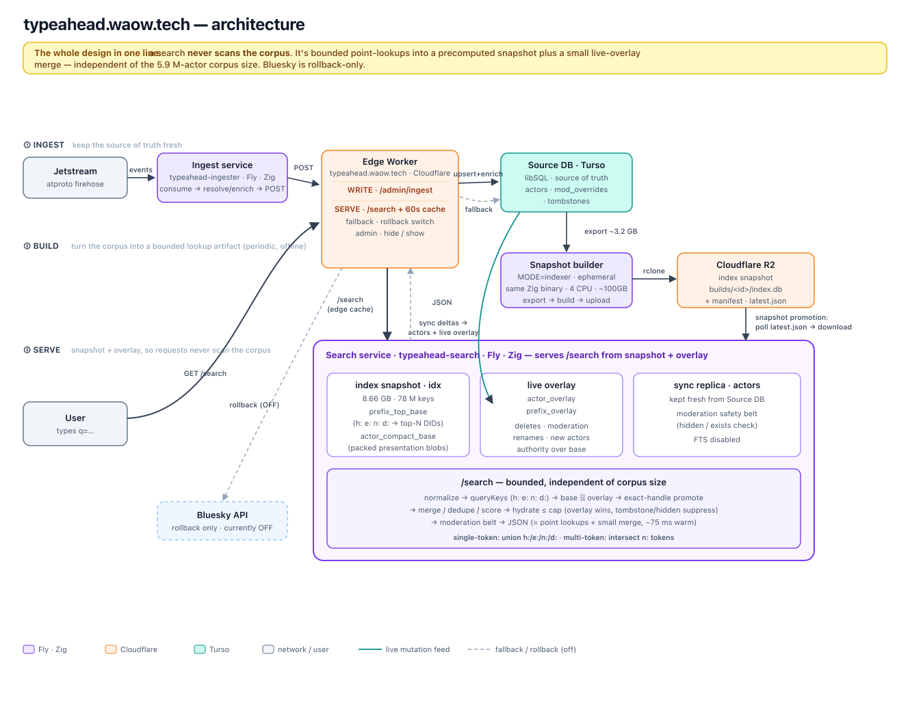

# typeahead

community actor search for [atproto](https://atproto.com). aims to be a drop-in replacement for `app.bsky.actor.searchActorsTypeahead` — same endpoint path and query params, returns the full `profileViewBasic` surface minus `viewer` (`did`, `handle`, `displayName`, `avatar`, `associated`, `labels`, `createdAt`).

**live:** https://typeahead.waow.tech

```bash
curl "https://typeahead.waow.tech/xrpc/app.bsky.actor.searchActorsTypeahead?q=nate&limit=10"
```

## stack



- **edge worker**: [Cloudflare Worker](https://workers.cloudflare.com) in `src/`.
  It owns the public XRPC-compatible endpoint, 60s edge cache, admin ingest
  endpoint, Turso fallback, and the Bluesky rollback kill switch.
- **ingest service**: [Zig](https://ziglang.org) on [Fly.io](https://fly.io),
  `typeahead-ingester`. It streams profiles, posts, likes, and follows via
  [Jetstream](https://docs.bsky.app/blog/jetstream), resolves identities, and
  batches actor updates to the worker.
- **source DB**: [Turso](https://turso.tech) / libSQL. It is the durable source
  of truth for actors, moderation overrides, and tombstones.
- **snapshot builder**: same Zig binary, `MODE=indexer`, run as an ephemeral Fly
  job. It exports Turso, builds a precomputed prefix-index SQLite snapshot, and
  publishes `index.db` + `latest.json` to Cloudflare R2.
- **search service**: same Zig binary, `typeahead-search`. It downloads and
  verifies snapshots from R2, attaches them read-only, tails Turso into a local
  actor replica, projects live changes into an overlay, and serves `/search`
  from bounded point lookups. Local FTS is disabled here.
- **identity**: [slingshot](https://microcosm.blue) for on-demand handle
  resolution.

The serving invariant: no request does work proportional to the actor corpus.
The request path reads a small set of precomputed prefix keys, merges the live
overlay, hydrates a capped list of actors, and returns JSON. Bluesky is rollback
only, not part of the normal serving path.

## layout

- `src/` — Cloudflare Worker.
- `services/` — shared Zig service code. It builds three Fly roles from one
  codebase: ingest service (`fly.toml`), search service (`fly.search.toml`),
  and snapshot builder (`fly.indexer.toml`).
- `scripts/` — local/ops scripts for smoke tests, benchmarks, backfills, and
  maintenance.
- `docs/` — architecture notes, design docs, retros, and diagrams.

## dev

```bash
# worker
bun install && bunx wrangler dev

# Zig services
just test-services      # cd services && zig build test --summary all
cd services && zig build run
```

The default Zig run mode is the long-running service binary. Fly config controls
the role:

- ingest service: Jetstream on, sync/search off as configured in `fly.toml`
- search service: Jetstream off, sync + index promotion + prefix search on in
  `fly.search.toml`
- snapshot builder: `MODE=indexer` in `fly.indexer.toml`

The ingest service requires `TYPEAHEAD_URL` and `TYPEAHEAD_SECRET`. R2 and Turso
credentials are provided as Fly/Worker secrets in production.

## deploy

```bash
just deploy-worker    # edge worker to Cloudflare (manual; CI auto-deploy needs CLOUDFLARE_API_TOKEN set)
just deploy-ingest    # ingest service  (App A, fly.toml)
just deploy-search    # search service  (App B, fly.search.toml)
```

The snapshot builder is launched as a one-off Fly machine from
`services/fly.indexer.toml` (`just indexer-build-staging` for an isolated
staging build); it is not a long-running service. See `docs/operations.md`.
