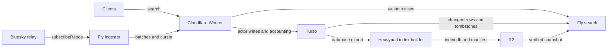

# typeahead

Community actor search for [atproto](https://atproto.com).

[Search](https://typeahead.waow.tech/) · [Stats](https://typeahead.waow.tech/stats) · [API docs](https://typeahead.waow.tech/docs) · [Machine-readable docs](https://typeahead.waow.tech/llms.txt)

```sh
curl 'https://typeahead.waow.tech/xrpc/tech.waow.typeahead.searchActors?q=nate&limit=10'
```

Returns the `profileViewBasic` fields without viewer state: `did`, `handle`,
`displayName`, `avatar`, `associated`, `labels`, and `createdAt`. The
[self-owned lexicon](lexicons/tech.waow.typeahead.searchActors.json) defines the
canonical endpoint. `/xrpc/app.bsky.actor.searchActorsTypeahead` remains a
compatible alias with identical parameters and response.

Profile cards use `/xrpc/app.bsky.actor.getProfiles?actors=…` (up to 25 actors)
or `/xrpc/app.bsky.actor.getProfile?actor=…`. They include available profile
and enrichment fields; counts are omitted until enriched. No viewer state.

## How it works



- **Worker:** public endpoints, a 60-second search cache, admin ingestion,
  request accounting, and profile APIs. Turso search fallbacks are opt-in.
  Bluesky is an explicit rollback option, not the normal search backend.
- **Ingester:** Zig on Fly, consuming the relay's `subscribeRepos` firehose
  (not Jetstream). Profile and activity events become batched actor updates.
  Failed writes retain their queues and apply backpressure; startup resumes
  from the persisted relay cursor. Identity events enter the protected discovery
  queue, and each one is re-resolved from its DID authority with the handle
  verified both ways, so a handle change lands within seconds. Watchdog exits and
  panics terminate on a deadman that does not depend on telemetry flushing.
- **Turso:** durable actor records, moderation overrides, and tombstones.
  Ingestion, enrichment, and request accounting share its writer.
- **Index builder:** the same Zig codebase in `MODE=indexer`, orchestrated by
  Prefect on heavypad every three days. It exports Turso, builds prefix-to-actor
  lists and compact profiles, and publishes a SQLite snapshot to R2. It is an
  offline batch job; an unsuccessful build leaves the previous snapshot serving.
- **Search:** Zig on Fly. It verifies and attaches the R2 snapshot read-only,
  then pulls newer Turso rows into a mutable overlay approximately every five
  minutes. Queries merge snapshot and overlay candidates, promote exact handles,
  hydrate profiles, and apply moderation. There is no separate full actor-table
  replica on the serving machine; the snapshot itself contains compact profiles.
- **Maintenance:** Prefect jobs on heavypad handle identity and profile
  enrichment, including weekly PLC processing for rows with no handle yet
  (they do not correct a stale handle; the ingester does). The hourly Worker cron handles
  freshness, statistics, and moderation refresh—not bulk enrichment.

Compact snapshots are not yet serving production (status verified October 17,
2026). Candidate `cc2d5a1` has passed independent disaster restoration, legacy
binary rollback, complete live replay, restart admission, the isolated ranking
suite, and 224 current-Worker alias/cache checks. Its complete 180-trial cold
campaign passed all primary gates; compact startup took about 205 seconds, so
cutover requires an already-ready replacement.

The [uncapped warm run](docs/evals/compact-cancel-fixed-warm/gate.json) remains
inconclusive under the unchanged no-regression gate: mixed-read p95 upper
confidence bound is +3.5%. Native matched reload qualification passed all 60 trials with no secondary
regression flags.
The unmodified legacy performance control crashed during concurrent reads;
that comparison is incomplete, with its failure retained. Nate accepted these
two exceptions on October 17, conditional on the now-passing reload gate. Production cutover,
scheduled compact publication, daily observation, and final cleanup are pending.
See the [cutover runbook](docs/plans/compact-production-cutover.md) for current
inventory and evidence, and the [rollout gates](docs/plans/snapshot-compaction-rollout.md)
for acceptance criteria. Earlier candidates' passing results do not qualify this
replacement.

The latest recorded approved Worker is `f109afd8…`; its compact-ID freshness
parser fix is prepared and tested locally, not deployed. Refresh the active
Worker before shipping to preserve concurrent stats changes. Four completed Fly
qualification machines are stopped with volumes retained; the isolated replacement
and legacy production backend remain running.

The current-generation compact pair is 6.96 GB, over 50% smaller than the original
and VACUUM reference. Local legacy twins remain mandatory for recovery; repeated
promotion needs about 45.2 GB for two complete pairs before overlay and temporary
files, so smaller production volumes are not yet justified. Empty-overlay recovery
also requires a snapshot inside the seven-day tombstone replay window; archived
images alone do not preserve that window.

The offline converter uses a Zig shared library for packing and exhaustive
record verification; Python validates manifests and stages the finished pair.
Build it with `just build-compactor`, test with `just test-compactor`, and use
`just convert-quiet --source ... --manifest ... --output ... --build-id ...` on
HeavyPad to cap the entire conversion at 20% of one CPU. See
[native conversion](docs/native-compaction.md) for the format contract,
measurements, and scheduler integration status.

The experimental compact reader caches at most 128 ordinary 8 KiB pages per
read-pool slot (1 MiB each, 8 MiB with eight slots). Each exclusive lease owns its
slot cache; snapshot activation invalidates every slot before new leases can
read. Oversized pages use the existing bounded scratch path. This remains
unshipped pending the complete release gates; see
[the diagnostic evidence](docs/evals/compact-read-cache.json) and
[exact-release recovery checks](docs/evals/compact-cache-release-checks.json).

The snapshot precomputes search candidates. Union-prefix overlay additions use a
partial `(key, score DESC, did ASC)` index and stop after the top 50, plus indexed
corrections to snapshot candidates. Exact keys and intersections retain full
matching-key reads to preserve ranking correctness. Hydration is capped at 50
before exact-handle reinjection. Queries longer than 16 bytes use their 16-byte
prefix key and filter hydrated rows against the full query. See
[architecture](docs/architecture.md) and [lookup evaluation](docs/evals/bounded-overlay.md).
The ranking index was installed on the production overlay on October 9.
Its idempotent initialization change is on `codex/overlay-ranking`; the running
service image was not replaced.

## Public pages and metadata

The Worker serves the homepage (`/`), `/stats`, `/docs`, `/reputation`, and
`/llms.txt`, all from `src/pages/` on one shared theme. Dated state:

- Homepage navigation (September 6, 2026): `[src]` and `[llms.txt]` share the
  project-resource row; the theme control sits at the right; attribution,
  stats, and docs are in the footer.
- Link previews (September 20, 2026): every page's description leads with what
  typeahead does and where it looks, and does not define the service by what
  it replaces. The card at `/og-image` (`src/handlers/og.ts`) reads the hourly
  stats KV blob, never Turso, and shows four cumulative figures: actors indexed
  with handle coverage, avatar coverage, apps that have ever sent a search, and
  searches answered all time. The app count is a filtered `traffic_sources`
  count the cron materializes as `traffic_sources_total`. Embedders cache cards
  by URL, so `CARD_VERSION` in `src/pages/theme.ts` must be bumped whenever the
  card changes.
- App metadata (September 20, 2026): the mark is served at `/favicon.svg`,
  rasterized at `/apple-touch-icon.png`, and declared in `/site.webmanifest`.
  A `data:` favicon preceded this; crawlers and home-screen installs could not
  read it.

"Hidden by moderation" left the card on September 20, 2026. That count is
label observations from the refresh cron, not enforcement: PDS-level
suspensions arrive as `#account` events and are deleted, and appview takedowns
are re-enriched visible by policy. See
[operations](docs/operations.md#the-hidden-count-is-sampling-not-enforcement-2026-09-20).

## Operational status

As of September 6, 2026:

- Search runs on one Fly machine: 4 shared CPUs, 2 GiB RAM, and a 60 GB volume.
  Ingester runs separately on 1 shared CPU and 256 MiB RAM.
- The ingest retry/cursor fixes are deployed. Historical recovery restored and
  search-verified 377 accounts; remaining historical uncertainty is documented
  in the [recovery closeout](docs/retros/2026-09-05-ingester-recovery-closeout.md).
- Bulk profile enrichment is paused following writer contention. A guarded
  workflow is prepared locally in `my-prefect-server`; it is not deployed.
- The bounded overlay lookup went live on the serving machine on
  2026-09-09 05:34 UTC: it was on main and shipped with the deadman exit-path
  deploy, ahead of the staged rollout the canary was preparing. `/debug/search`
  reports `overlay_bounded: true` on union keys. Before that it had passed the
  shadow canary's 18/18 live-query comparisons, all 36 full-overlay query cases
  (11.16M prefix rows) and 108 concurrent-update comparisons. The ranking
  index is NOT installed in production: it adds 543 MiB and increases
  projection write work, and without it SQLite still visits and sorts every
  matching prefix row before the bound applies. The stopped canary machine and
  its temporary 60 GB volume were deleted on 2026-09-28; evaluation evidence is preserved and the ranking-index experiment
  remains deferred. See the [evaluation](docs/evals/bounded-overlay.md)
  and [canary limits and rollback](ops/canary/README.md).

These are dated observations, not configuration sources. Fly role configs live in
`services/`; Prefect schedules and deployment definitions live in
[`my-prefect-server`](https://tangled.org/zzstoatzz.io/my-prefect-server).

## Development

```sh
bun install
just check             # Worker types, lint, tests, deployment dry-run
just test-services     # Zig unit tests
bunx wrangler dev      # local Worker
```

The Zig binary requires `MODE=ingester`, `MODE=search`, or `MODE=indexer`.
There is no default role. Use the role's configuration and credentials; a bare
`zig build run` is not a configured local service.

- `src/` — Worker handlers, public pages, and shared page theme.
- `services/` — Zig ingester, search, and index builder.
- `deploy/home-indexer/` — heavypad prerequisites.
- `scripts/` — smoke checks, benchmarks, recovery tools, and offline experiments.
- `ops/` — health exporter and dashboard tooling.
- `docs/` — architecture, operations, evaluations, and dated retrospectives.

Repository instructions live in [AGENTS.md](AGENTS.md).
`.claude/CLAUDE.md` is a symlink to that same file.

## Deployment and validation

```sh
just deploy-worker     # Cloudflare deploy, then smoke checks
just deploy-ingest     # Fly ingester
just deploy-search     # Fly search
```

These commands affect production. Search currently has a single serving machine;
use an isolated target for performance experiments and account for availability
before replacing it. Benchmarks and smoke scripts may default to production;
check their target and whether they perform writes before running them.

The home builder is deployed through Prefect. `services/fly.indexer.toml` remains
an optional manual Fly rollback path, not the scheduled builder. See
[operations](docs/operations.md).

## Costs

The existing [hub cost snapshot](https://hub.waow.tech/api/costs.json) reports
project-attributed line items and their estimation basis. Turso and Cloudflare
subscriptions are shared with other projects; their whole account invoices are
not Typeahead's cost. [COSTS.md](COSTS.md) retains dated historical research;
do not use its older resource sizes or totals as current estimates.
