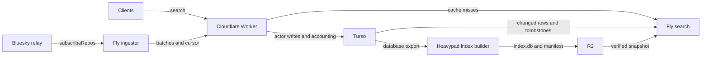

# typeahead

Community actor search for [atproto](https://atproto.com).

[Search](https://typeahead.waow.tech/) · [Stats](https://typeahead.waow.tech/stats) · [API docs](https://typeahead.waow.tech/docs) · [Machine-readable docs](https://typeahead.waow.tech/llms.txt)

```sh
curl 'https://typeahead.waow.tech/xrpc/tech.waow.typeahead.searchActors?q=nate&limit=10'
```

Returns the `profileViewBasic` fields without viewer state: `did`, `handle`,
`displayName`, `avatar`, `associated`, `labels`, and `createdAt`. The
[self-owned lexicon](lexicons/tech.waow.typeahead.searchActors.json) defines the
canonical endpoint. `/xrpc/app.bsky.actor.searchActorsTypeahead` remains a
compatible alias with identical parameters and response.

Profile cards use `/xrpc/app.bsky.actor.getProfiles?actors=…` (up to 25 actors)
or `/xrpc/app.bsky.actor.getProfile?actor=…`. They include available profile
and enrichment fields; counts are omitted until enriched. No viewer state.

## How it works



- **Worker:** public endpoints, a 60-second search cache, admin ingestion,
  request accounting, and profile APIs. Turso search fallbacks are opt-in.
  Bluesky is an explicit rollback option, not the normal search backend.
- **Ingester:** Zig on Fly, consuming the relay's `subscribeRepos` firehose
  (not Jetstream). Profile and activity events become batched actor updates.
  Failed writes retain their queues and apply backpressure; startup resumes
  from the persisted relay cursor. Identity events enter the protected discovery
  queue, with asynchronous resolution as an optimization. Watchdog exits and
  panics terminate on a deadman that does not depend on telemetry flushing.
- **Turso:** durable actor records, moderation overrides, and tombstones.
  Ingestion, enrichment, and request accounting share its writer.
- **Index builder:** the same Zig codebase in `MODE=indexer`, orchestrated by
  Prefect on heavypad every three days. It exports Turso, builds prefix-to-actor
  lists and compact profiles, and publishes a SQLite snapshot to R2. It is an
  offline batch job; an unsuccessful build leaves the previous snapshot serving.
- **Search:** Zig on Fly. It verifies and attaches the R2 snapshot read-only,
  then pulls newer Turso rows into a mutable overlay approximately every five
  minutes. Queries merge snapshot and overlay candidates, promote exact handles,
  hydrate profiles, and apply moderation. There is no separate full actor-table
  replica on the serving machine; the snapshot itself contains compact profiles.
- **Maintenance:** Prefect jobs on heavypad handle identity and profile
  enrichment, including weekly PLC processing. The hourly Worker cron handles
  freshness, statistics, and moderation refresh—not bulk enrichment.

The snapshot precomputes search candidates, but **the deployed overlay lookup
can still scan a large matching prefix**. Candidate hydration is capped at 50
before exact-handle reinjection. A capped result list does not imply bounded
SQLite work. See [architecture](docs/architecture.md) and
[discovery and identity](docs/discovery-and-identity.md).

## Operational status

As of September 6, 2026:

- Search runs on one Fly machine: 4 shared CPUs, 2 GiB RAM, and a 60 GB volume.
  Ingester runs separately on 1 shared CPU and 256 MiB RAM.
- The ingest retry/cursor fixes are deployed. Historical recovery restored and
  search-verified 377 accounts; remaining historical uncertainty is documented
  in the [recovery closeout](docs/retros/2026-09-05-ingester-recovery-closeout.md).
- Bulk profile enrichment is paused following writer contention. A guarded
  workflow is prepared locally in `my-prefect-server`; it is not deployed.
- The bounded overlay lookup went live on the serving machine on
  2026-09-09 05:34 UTC: it was on main and shipped with the deadman exit-path
  deploy, ahead of the staged rollout the canary was preparing. `/debug/search`
  reports `overlay_bounded: true` on union keys. Before that it had passed the
  shadow canary's 18/18 live-query comparisons, all 36 full-overlay query cases
  (11.16M prefix rows) and 108 concurrent-update comparisons. The ranking
  index is NOT installed in production: it adds 543 MiB and increases
  projection write work, and without it SQLite still visits and sorts every
  matching prefix row before the bound applies. The canary machine is stopped
  with its volume attached. See the [evaluation](docs/evals/bounded-overlay.md)
  and [canary limits and rollback](ops/canary/README.md).

These are dated observations, not configuration sources. Fly role configs live in
`services/`; Prefect schedules and deployment definitions live in
[`my-prefect-server`](https://tangled.org/zzstoatzz.io/my-prefect-server).

## Development

```sh
bun install
just check             # Worker types, lint, tests, deployment dry-run
just test-services     # Zig unit tests
bunx wrangler dev      # local Worker
```

The Zig binary requires `MODE=ingester`, `MODE=search`, or `MODE=indexer`.
There is no default role. Use the role's configuration and credentials; a bare
`zig build run` is not a configured local service.

- `src/` — Worker handlers, public pages, and shared page theme.
- `services/` — Zig ingester, search, and index builder.
- `deploy/home-indexer/` — heavypad prerequisites.
- `scripts/` — smoke checks, benchmarks, recovery tools, and offline experiments.
- `ops/` — health exporter and dashboard tooling.
- `docs/` — architecture, operations, evaluations, and dated retrospectives.

Repository instructions live in [AGENTS.md](AGENTS.md).
`.claude/CLAUDE.md` is a symlink to that same file.

## Deployment and validation

```sh
just deploy-worker     # Cloudflare deploy, then smoke checks
just deploy-ingest     # Fly ingester
just deploy-search     # Fly search
```

These commands affect production. Search currently has a single serving machine;
use an isolated target for performance experiments and account for availability
before replacing it. Benchmarks and smoke scripts may default to production;
check their target and whether they perform writes before running them.

The home builder is deployed through Prefect. `services/fly.indexer.toml` remains
an optional manual Fly rollback path, not the scheduled builder. See
[operations](docs/operations.md).

## Costs

The existing [hub cost snapshot](https://hub.waow.tech/api/costs.json) reports
project-attributed line items and their estimation basis. Turso and Cloudflare
subscriptions are shared with other projects; their whole account invoices are
not Typeahead's cost. [COSTS.md](COSTS.md) retains dated historical research;
do not use its older resource sizes or totals as current estimates.

Homepage navigation (deployed September 6, 2026): `[src]` and `[llms.txt]` share the project-resource row;
theme control sits at the right, with attribution, stats and docs in the footer.
