# typeahead

Community actor search for [atproto](https://atproto.com).

[Search](https://typeahead.waow.tech/) · [Stats](https://typeahead.waow.tech/stats) · [API docs](https://typeahead.waow.tech/docs) · [Machine-readable docs](https://typeahead.waow.tech/llms.txt)

```sh
curl 'https://typeahead.waow.tech/xrpc/tech.waow.typeahead.searchActors?q=nate&limit=10'
```

Returns the `profileViewBasic` fields without viewer state: `did`, `handle`,
`displayName`, `avatar`, `associated`, `labels`, and `createdAt`. The
[self-owned lexicon](lexicons/tech.waow.typeahead.searchActors.json) defines the
canonical endpoint. `/xrpc/app.bsky.actor.searchActorsTypeahead` remains a
compatible alias with identical parameters and response.

**Live since October 20, 2026, 15:19 UTC:** optional `pds=acme.com`
searches by indexed hosting PDS before candidate selection, including custom-domain
handles. The snapshot builds scopes only for PDSs with at most 10,000 known actor
rows at snapshot time (`INDEX_PDS_MAX_ACTORS`, configurable). Larger PDSs return
503 `PdsScopeUnavailable`; their global results remain available. The PDS-scoped lists are additional to the global lists; requests without
`pds` retain their existing behavior. Unknown hosts return an empty list; missing
backend/snapshot support returns 503 instead of unfiltered results. Hostnames are
case-insensitive and exact (no subdomain expansion); HTTP(S) origins and a trailing
slash/dot are accepted, ports and paths are rejected. See the
[correctness/performance evaluation and rollout gates](docs/evals/pds-scope.md).
The homepage filter sits inside the search field and stays closed by default,
including when a shared URL selects a PDS. Opening it reveals a hostname panel
without changing the page layout. An available PDS favicon
replaces the filter icon while selected; missing icons retain the sliders. See the
[compact integration review](docs/evals/pds-homepage-20261020.md).
Full-corpus qualification covered 12.64 million searchable actors, 2,223 eligible
PDS hosts, paired global/scoped comparisons, rollback and empty-root restoration.
The public API, browser flow and Logfire spans were verified after deployment.

PDS membership is incomplete: the October 20 source export had 9.88 million
of 12.65 million actor rows without a hosting PDS. The weekly identity job
selected missing handles rather than missing PDS values. Two guarded repairs
have been verified; full repair and recurring coverage remain unfinished. Repair execution is stopped
after [cleanup of abandoned experiments](docs/pds-repair-cleanup-20261020.md).
The retained [repair tooling](docs/pds-identity-repair.md) includes transfer limits,
conditional writes and durable receipts. These tools do not enable bulk writes
or change the deployed 10,000-actor filter cutoff.
The [October 20 parser-fix cutover](docs/evals/pds-parser-cutover-20261020.md)
rejects failed replay queries before declaring readiness. Smoke, scoped aliases and Logfire were verified after that transition.
The superseded backends and disks were retired October 25 after qualification of
the two-CPU / 1 GiB admitted-startup backend; see the
[retirement record](docs/ops/automatic-refresh-20261025.md#superseded-backend-retirement).
Obsolete home datasets were also retired; the [storage audit](https://tangled.org/zzstoatzz.io/my-prefect-server/blob/main/docs/audits/2026-10-25-worker-disk-cleanup.md) records retained evidence and retention fixes.
Search telemetry provisioning and production-slot sync monitoring are covered in
the [refresh runbook](docs/plans/automatic-snapshot-refresh.md#search-telemetry).
The [October 26 repair](docs/ops/search-monitoring-20261026.md) restores search
telemetry and makes sync monitoring follow the routed production backend.
The later [search-timeout RCA and retro](docs/retros/2026-10-26-search-timeouts-and-freshness-alerts.md)
records actual search failures and the remaining admission, API error and alert-recovery work;
restored telemetry does not close those serving reliability issues.
The [sync hardening follow-up](docs/operations.md#sync-hardening-follow-up-october-27-2026-live)
adds bounded retries, HTTP-client recovery and stricter watchdog feeding; it is
live October 27 on two CPUs / 1 GiB. The release also repairs the unsearchable-actor
query’s missing `COLLATE NOCASE`, which timed out during isolated replay.

The active [safe performance goal](docs/evals/perf-goal-20261027/plan.md) targets
warm mixed-workload native p95 ≤50 ms / p99 ≤100 ms at two CPUs / 1 GiB, with
unchanged search outcomes and failure-inclusive accounting. These are acceptance
targets, not deployed guarantees. Corpus qualification and rollout remain pending.

The [October 27 system-health audit](docs/evals/system-health-20261027/README.md)
identifies storage wait and repeated overlay writes as efficiency targets.
Guarded replay writes and finer search/sync phase timings are tested locally
and in an isolated archived-corpus comparison, not deployed; the live configuration remains two CPUs / 1 GiB. A separate local transport
candidate overlaps route validation with read-only origin work; its live gain
and rollout remain unqualified.

Profile cards use `/xrpc/app.bsky.actor.getProfiles?actors=…` (up to 25 actors)
or `/xrpc/app.bsky.actor.getProfile?actor=…`. They include available profile
and enrichment fields; counts are omitted until enriched. No viewer state.

## How it works

```mermaid
flowchart LR
  Clients -->|search| Worker[Cloudflare Worker]
  Relay[Bluesky relay] -->|subscribeRepos| Ingester[Fly ingester]
  Ingester -->|batches and cursor| Worker
  Worker -->|actor writes and accounting| Turso
  Worker -->|cache misses, private binding| Transport[Origin transport Worker, US East]
  Routing[R2 routing record] --> Transport
  Transport --> Search[Serving Fly search]
  Turso -->|changed rows and tombstones| Search
  Turso -->|database export| Builder[Cloud Prefect builder]
  Builder -->|verified immutable artifacts| R2
  R2 --> Installer[Idle Fly slot, independent disk]
  Installer -->|admission and query gates| Controller[Refresh controller]
  Controller -->|conditional promotion| Routing
```



Search response timing and the October 20 cold-edge investigation are recorded in
[the latency evaluation](docs/evals/edge-latency-20261020.md). Engine timings alone
do not establish public request latency. The homepage opens results after the
answer arrives, without a transient loading dropdown.

- **Worker:** public endpoints, a 60-second search cache, admin ingestion,
  request accounting, and profile APIs. Turso search fallbacks are opt-in.
  Cache misses use a private transport Worker placed in US East to avoid
  measured overseas origin detours; cache hits stay at the edge.
  Bluesky is an explicit rollback option, not the normal search backend.
- **Ingester:** Zig on Fly, consuming the relay's `subscribeRepos` firehose
  (not Jetstream). Profile and activity events become batched actor updates.
  Failed writes retain their queues and apply backpressure; startup resumes
  from the persisted relay cursor. Identity events enter the protected discovery
  queue, and each one is re-resolved from its DID authority with the handle
  verified both ways, so a handle change lands within seconds. Watchdog exits and
  panics terminate on a deadman that does not depend on telemetry flushing.
- **Turso:** durable actor records, moderation overrides, and tombstones.
  Ingestion, enrichment, and request accounting share its writer.
- **Index builder:** the same Zig codebase in `MODE=indexer`, orchestrated by
  Prefect on a resource-limited cloud worker. It exports Turso, builds prefix lists
  and compact profiles, and fully verifies immutable artifacts in R2. A controller
  installs onto an idle backend with its own disk; failed preparation leaves the
  serving backend untouched. See the [refresh runbook](docs/plans/automatic-snapshot-refresh.md)
  for qualification and scheduling status.
- **Search:** Zig on Fly. Installation fully validates the snapshot and records
  admission tied to the exact files. Restart checks that admission and attaches
  read-only metadata without rescanning the corpus; pages load on demand. Newer
  Turso rows enter a mutable overlay approximately every five minutes. Queries
  merge snapshot and overlay candidates, promote exact handles, hydrate profiles,
  and apply moderation. The previous backend remains available for routing rollback.
- **Maintenance:** Prefect jobs on heavypad handle identity and profile
  enrichment. Weekly PLC processing remains paused;
  its existing selector covers rows with no handle yet
  (it does not correct stale handles; the ingester does). The hourly Worker cron handles
  freshness, statistics, and moderation refresh—not bulk enrichment.

Compact snapshots have served production since October 17, 2026. The
[compact release record](docs/plans/compact-production-cutover.md) and
[PDS cutover record](docs/evals/pds-parser-cutover-20261020.md) retain the historical
qualification, performance exceptions and recovery evidence. The October 25
[automatic refresh record](docs/ops/automatic-refresh-20261025.md) supersedes their
serving inventory and shared-pointer installation procedure.

Each serving slot holds one compact snapshot plus its live overlay. The
same-watermark legacy twin stays in R2; it is not downloaded onto the serving disk.
Current and previous artifacts remain protected remotely, and the previous backend
keeps its independent disk for routing rollback. A fresh 20 GB slot passed full
installation and restart qualification. Recovery still needs a snapshot inside
the seven-day tombstone replay window. Routing to an incompatible historical
backend requires explicitly disabling PDS search first; preserve the public
Worker's unrelated changes.

The offline converter uses a Zig shared library for packing and exhaustive
record verification; Python validates manifests and stages the finished pair.
Build it with `just build-compactor`, test with `just test-compactor`, and use
`just convert-quiet --source ... --manifest ... --output ... --build-id ...` on
HeavyPad to cap the entire conversion at 20% of one CPU. See
[native conversion](docs/native-compaction.md) for the format contract,
measurements, and scheduler integration status.

The experimental compact reader caches at most 128 ordinary 8 KiB pages per
read-pool slot (1 MiB each, 8 MiB with eight slots). Each exclusive lease owns its
slot cache; snapshot activation invalidates every slot before new leases can
read. Oversized pages use the existing bounded scratch path. This remains
unshipped pending the complete release gates; see
[the diagnostic evidence](docs/evals/compact-read-cache.json) and
[exact-release recovery checks](docs/evals/compact-cache-release-checks.json).

The snapshot precomputes search candidates. Union-prefix overlay additions use a
partial `(key, score DESC, did ASC)` index and stop after the top 50, plus indexed
corrections to snapshot candidates. Exact keys and intersections retain full
matching-key reads to preserve ranking correctness. Hydration is capped at 50
before exact-handle reinjection. Queries longer than 16 bytes use their 16-byte
prefix key and filter hydrated rows against the full query. See
[architecture](docs/architecture.md) and [lookup evaluation](docs/evals/bounded-overlay.md).
The ranking index was installed on the production overlay on October 9.
Its idempotent initialization change is on `codex/overlay-ranking`; the running
service image was not replaced.

## Public pages and metadata

The Worker serves the homepage (`/`), `/stats`, `/docs`, `/reputation`, and
`/llms.txt`, all from `src/pages/` on one shared theme. Dated state:

- Ranking explainer (October 20, 2026): `/reputation` has a three-row summary
  with small section icons and expandable weights. Entering a handle collapses the guide; account reports
  show score, visibility, and moderation, followed by expandable details.
  [Deployment verification](docs/evals/ranking-page-20261020.md). Ranking and
  the report API are unchanged.
- Homepage navigation (September 6, 2026): `[src]` and `[llms.txt]` share the
  project-resource row; the theme control sits at the right; attribution,
  stats, and docs are in the footer.
- Link previews (September 20, 2026): every page's description leads with what
  typeahead does and where it looks, and does not define the service by what
  it replaces. The card at `/og-image` (`src/handlers/og.ts`) reads the hourly
  stats KV blob, never Turso, and shows four cumulative figures: actors indexed
  with handle coverage, avatar coverage, apps that have ever sent a search, and
  searches answered all time. The app count is a filtered `traffic_sources`
  count the cron materializes as `traffic_sources_total`. Embedders cache cards
  by URL, so `CARD_VERSION` in `src/pages/theme.ts` must be bumped whenever the
  card changes.
- App metadata (September 20, 2026): the mark is served at `/favicon.svg`,
  rasterized at `/apple-touch-icon.png`, and declared in `/site.webmanifest`.
  A `data:` favicon preceded this; crawlers and home-screen installs could not
  read it.

"Hidden by moderation" left the card on September 20, 2026. That count is
label observations from the refresh cron, not enforcement: PDS-level
suspensions arrive as `#account` events and are deleted, and appview takedowns
are re-enriched visible by policy. See
[operations](docs/operations.md#the-hidden-count-is-sampling-not-enforcement-2026-09-20).

Stats interactions (October 17, 2026) keep the donut stationary during repeated
selections. The activity card uses aligned search/latency metrics and compact
comparison pills whose DOM nodes and icon slots remain stable during selection.
The larger SVG ring preserves twelve sources plus a remainder, with exact source
details shown on selection rather than printed on slices. “Explore … more”
zooms into the remainder; “Back to top apps” returns directly to the original
view at any depth, and breadcrumbs return to intermediate levels. This action does
not depend on identifying a color. Selected apps have checkmarks and selected
slices have outlines. Brand icons and operator avatars appear on slices where
they fit; the same sources are used in the pills. Icons remain upright, and
resize/drill-down recomputes fit without crowding narrow slices.

One complete app pill list replaces the duplicate table. Search, batches of 50,
and show-all expose every app. A “Show all / Show fewer” control above the
list stays synchronized with the bottom controls, so collapsing never requires
scrolling to the end. Pills retain percentages; selection shows exact
request counts and shares together inside the ring, with its website link. The
header keeps overall totals visible. Deselecting the inspected app returns the
center to the total rather than an older comparison; the repeated root breadcrumbs and detached
detail row are removed. Long names wrap up to three lines in the center; the
complete name remains in its pill. Six verified brand API mappings supply icons,
with domain favicon and marker fallbacks.

Source totals count cache misses; endpoint/status totals count all answered
requests. Comparisons, total-line visibility, and link/image/CSV exports remain
available. Secondary text has stronger contrast, the mobile moderation metric
spans its row, and the footer has one short “Add your app” link.

The October 19 follow-up matches the homepage’s 16px search input text to avoid
iPhone focus zoom while preserving pinch zoom. Deployed as Worker version
`86590349-5a6e-42c1-a6de-4c5d8835ff3b`. Deployment smoke passed. Live mobile and desktop checks verified logo loading,
correct slice placement, and tapping directly on an icon. The release preserves the deployed freshness fix and current backend routing. Live Chromium and WebKit checks cover selection, stable geometry,
recursive navigation, pagination through all apps, search, shared selections,
and dimensions in both themes at phone and desktop widths. Full-page visual
checks include 320px, 390px, and 1280px layouts.

Browser regression: `node scripts/test-stats-interactions.mjs <stats-page-url>`
(requires Playwright with Chromium and WebKit; `PLAYWRIGHT_MODULE` may point to an
existing installation).

## Operational status

October 27, 2026, 06:06 UTC: native sync hardening `f67005b` is live on
`typeahead-startup-20261024`, serving `b1792908655-14d5-px05` at two shared CPUs /
1 GiB. Public smoke checks passed; routed health and sync telemetry are present,
and freshness lag was 30 seconds. `typeahead-search-refresh` remains running
as the previous routing backend on its independent disk. See the
[release and sizing evidence](docs/ops/sync-hardening-release-20261026.md).

Automatic refresh builds and verifies artifacts in the cloud, qualifies the idle
slot, then changes routing conditionally. API/worker migration and schedule
ownership remain in `my-prefect-server`; consult its migration record before
changing clocks. PLC identity repair remains paused independently. Known serving
latency and admission issues remain open in the
[RCA](docs/retros/2026-10-26-search-timeouts-and-freshness-alerts.md).

As of September 6, 2026:

- Search runs on one Fly machine: 4 shared CPUs, 2 GiB RAM, and a 60 GB volume.
  The isolated [startup experiment](docs/evals/startup-buffer-20261024.md) tests
  buffered validation and metadata-only recovery; neither is deployed to production.
  Its [parallel candidate](docs/evals/startup-admitted-candidate-20261024.md) adds
  installation-time admission and block checksums before production qualification.
  Ingester runs separately on 1 shared CPU and 256 MiB RAM.
- The ingest retry/cursor fixes are deployed. Historical recovery restored and
  search-verified 377 accounts; remaining historical uncertainty is documented
  in the [recovery closeout](docs/retros/2026-09-05-ingester-recovery-closeout.md).
- Bulk profile enrichment is paused following writer contention. A guarded
  workflow is prepared locally in `my-prefect-server`; it is not deployed.
- The bounded overlay lookup went live on the serving machine on
  2026-09-09 05:34 UTC: it was on main and shipped with the deadman exit-path
  deploy, ahead of the staged rollout the canary was preparing. `/debug/search`
  reports `overlay_bounded: true` on union keys. Before that it had passed the
  shadow canary's 18/18 live-query comparisons, all 36 full-overlay query cases
  (11.16M prefix rows) and 108 concurrent-update comparisons. The ranking
  index is NOT installed in production: it adds 543 MiB and increases
  projection write work, and without it SQLite still visits and sorts every
  matching prefix row before the bound applies. The stopped canary machine and
  its temporary 60 GB volume were deleted on 2026-09-28; evaluation evidence is preserved and the ranking-index experiment
  remains deferred. See the [evaluation](docs/evals/bounded-overlay.md)
  and [canary limits and rollback](ops/canary/README.md).

An isolated [snapshot compaction experiment](docs/evals/flat-prefix-compaction.md)
preserves the serving snapshot's contents with 51.4% less disk than SQLite VACUUM.
All declared read-speed gates pass; the experiment is not deployed. The
[rollout plan](docs/plans/snapshot-compaction-rollout.md) covers paired artifacts,
production qualification, and overlay-safe rollback.

These are dated observations, not configuration sources. Fly role configs live in
`services/`; Prefect schedules and deployment definitions live in
[`my-prefect-server`](https://tangled.org/zzstoatzz.io/my-prefect-server).

## Development

```sh
bun install
just check             # Worker types, lint, tests, deployment dry-run
just test-services     # Zig unit tests
bunx wrangler dev      # local Worker
```

The Zig binary requires `MODE=ingester`, `MODE=search`, or `MODE=indexer`.
There is no default role. Use the role's configuration and credentials; a bare
`zig build run` is not a configured local service.

- `src/` — Worker handlers, public pages, and shared page theme.
- `services/` — Zig ingester, search, and index builder.
- `deploy/home-indexer/` — heavypad prerequisites.
- `scripts/` — smoke checks, benchmarks, recovery tools, and offline experiments.
- `ops/` — health exporter and dashboard tooling.
- `docs/` — architecture, operations, evaluations, and dated retrospectives.

Repository instructions live in [AGENTS.md](AGENTS.md).
Shared repository skills live in `.agents/skills/`, which Pi and Codex discover
directly. `.claude/skills/` contains compatibility symlinks for Claude Code.

## Deployment and validation

```sh
just deploy-worker     # Cloudflare deploy, then smoke checks
just deploy-ingest     # Fly ingester
```

These commands affect production. Backend refresh uses the isolated controller,
not `just deploy-search`, which remains guarded. Prepare binary changes on an
independent target and qualify the installer image before changing its immutable
pin in the publisher. Benchmarks and smoke scripts may default to production;
check their target and whether they perform writes before running them.

The cloud builder and isolated refresh controller are deployed through Prefect;
[the refresh runbook](docs/plans/automatic-snapshot-refresh.md) records current qualification
and scheduling. The old home bulk publisher remains disabled. `services/fly.indexer.toml` remains
an optional manual Fly rollback path, not the scheduled builder. See
[operations](docs/operations.md).

## Costs

As verified October 27, 2026, both managed search slots have two shared CPUs,
1 GiB RAM and independent 20 GB volumes. The earlier compact backend and its
60 GB disk were retired October 25. The ingester remains one shared CPU /
256 MiB. Retaining the previous managed backend provides immediate routing
rollback. [Verified serving state](docs/evals/sync-hardening-release-20261026/production-after.json).
The [October 24 retirement](docs/operations.md#search-rollback-resource-retirement--october-24-2026)
records the three older stopped machines and disks that were removed.

Use Evergreen's resource-attributed cost records and the verified operational
inventory. Trailing compute extrapolations can lag resource deletion. Turso and Cloudflare
subscriptions are shared with other projects; their whole account invoices are
not Typeahead's cost. [COSTS.md](COSTS.md) retains dated historical research;
do not use its older resource sizes or totals as current estimates.
