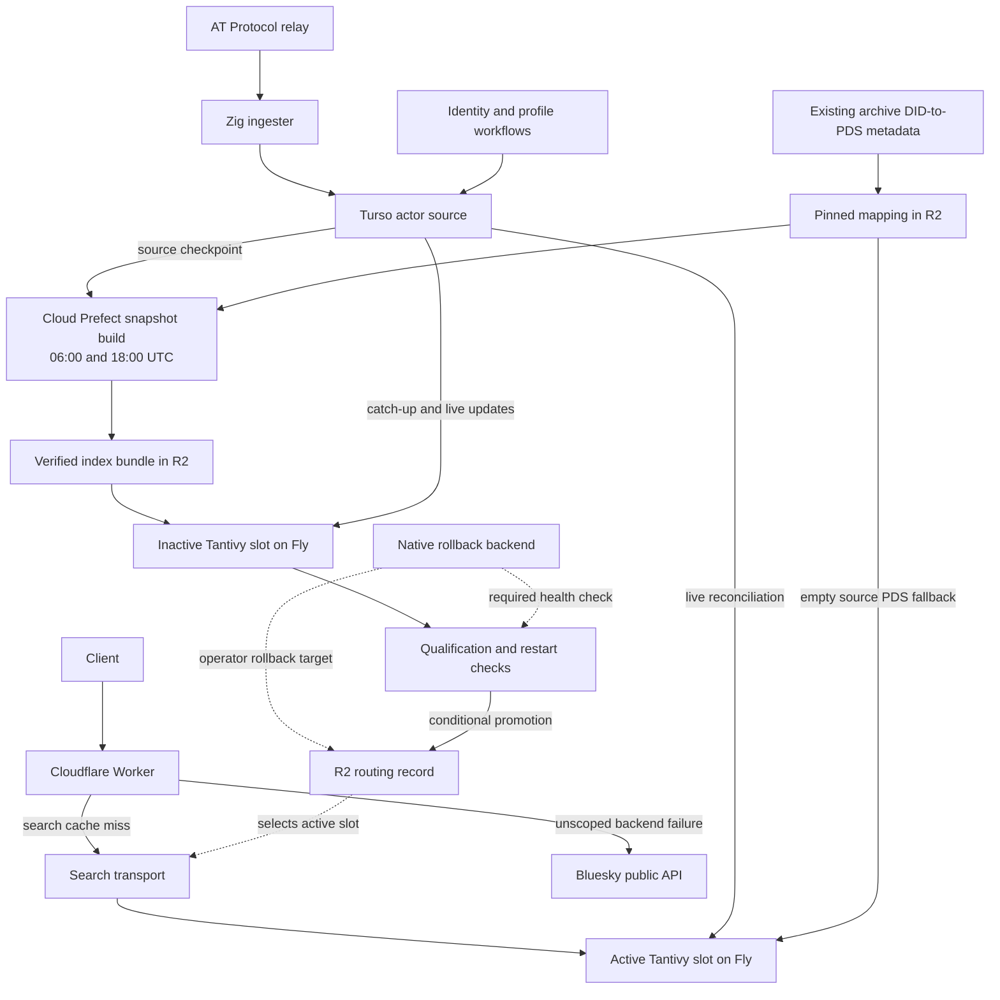

# Architecture

Typeahead keeps a searchable address book of accounts. It watches the network
for changes, saves them in a source database, and updates a fast search index.
When you type, it searches that index instead of asking every account's server.
Hosting information from the existing network archive fills gaps so you can also
search within a particular hosting server, or PDS.

Twice a day, it builds a fresh copy of the index on a separate backend, checks
that it works, and switches searches over. The serving copy keeps receiving live
updates between builds—you do not have to wait for the next rebuild to see changes.
A and B are the two backend slots that take turns doing those jobs.

If our search backend fails, ordinary searches automatically use Bluesky instead.
Searches restricted to a PDS return an explicit error because Bluesky cannot
honor that filter. A separate native backend is also retained for operator rollback;
the refresh controller currently requires it before promoting a new index.

## System diagram

A and B alternate serving and preparation roles. The previous backend is retained
for rollback; the native backend is a separate recovery dependency. The diagram
shows data flow and control dependencies, not
additional machines for each box. PDS-scoped requests never use Bluesky fallback.

## Search and profiles

Clients call the Cloudflare Worker through either search endpoint. The Worker
validates query scope, rate-limits, caches responses for 60 seconds and calls the
private transport, which resolves the qualified backend from the R2 routing record.
Tantivy retrieves complete matches, ranks them and returns stored actor profiles.
Failed, timed-out or invalid backend answers trigger automatic Bluesky fallback
for unscoped search. Fallback answers are not cached. PDS-scoped requests fail
with 503 instead of silently losing their scope; invalid parameters return 400.
There is no full-corpus Turso query fallback.

Exact eligible handles retain priority. PDS filtering uses canonical indexed
hosting identity before final selection; it does not filter a global top-N list.
`prefer_pds` retains global matches and applies PDS-first ordering or a score
boost. Unknown hosting metadata cannot match a host filter or preference.
Moderation eligibility is independent of ranking. The public API is unauthenticated
and does not provide viewer-specific state.

Profile-card endpoints serve the indexed profile data. Enrichment obtains data
from appviews separately; this is not an authenticated appview replacement.
See [/docs](https://typeahead.waow.tech/docs) for the public contract.

## Discovery and live updates

The Zig ingester follows `com.atproto.sync.subscribeRepos` and writes actor
changes to Turso. Identity resolution and profile enrichment remain separate
source-maintenance workflows. The [source adapter](../services/tantivy-input/README.md)
polls indexed change keys, reads current source observations and reconciles them
into Tantivy. Documents and source progress are committed durably together.
Deletes, renames and policy changes do not wait for a scheduled full build.

Timestamp polling and full reconciliation establish different facts. Source and
backend identity sweeps repair backdated changes and deletions that ordinary
polling can miss. A recent polling watermark does not prove full-source coverage.
PDS coverage uses source identity plus the pinned archive mapping described below,
not a per-host actor cap.

## Snapshot publication and refresh

The cloud Prefect `typeahead-index` deployment in my-prefect-server owns bulk
preparation on the `typeahead-ephemeral` pool. It exports a verified source
checkpoint, joins the pinned archive DID-to-PDS mapping only where source PDS is
empty, builds a Tantivy index and publishes a checksummed bundle and manifest
to R2. The same mapping is bound to live reconciliation and survives profile
updates; explicit source PDS changes take precedence. It does not backfill Turso.
The managed controller installs and qualifies the inactive Fly slot before
a conditional routing update. Bulk data does not travel through HeavyPad or the
operator laptop. A serving slot is never rebuilt in place.

The current schedule is 06:00 and 18:00 UTC. This 12-hour cadence renews source
coverage while full remote reconciliation remains unqualified; it is not an
inherent Tantivy requirement. Checkpoint coverage is bounded to 24 hours and can
be renewed by a qualifying completed remote round. Reducing rebuild frequency
requires evidence that reconciliation and long-running index maintenance meet
the serving requirements. See the [refresh runbook](plans/automatic-snapshot-refresh.md).

## Recovery and ownership

The active Tantivy machine uses two shared CPUs, 1 GiB RAM and a 20-GiB volume.
The dev frontend uses the same production frontend with its own backend binding.
The previous slot and native rollback have separate allocations; a serving
allocation is not the total infrastructure cost.

A cached restart reopens the admitted installation and resumes durable source
progress. Missing or invalid admission evidence requires qualification. Rollback
uses the independent native anchor and conditional route updates; cache generation
changes follow route convergence. An operator's newer route must never be overwritten
by compensation from an older operation.

The Worker retains API caching, request accounting and bounded health/statistics
work. It does not run corpus-scale indexing. Prefect owns build schedules; Fly
owns serving machines; R2 holds artifacts and routing metadata; Turso remains
the source of truth. The [deployment inventory](ops/test-resource-retirement-20261031/README.md)
is a dated receipt, not a substitute for checking live provider state.
