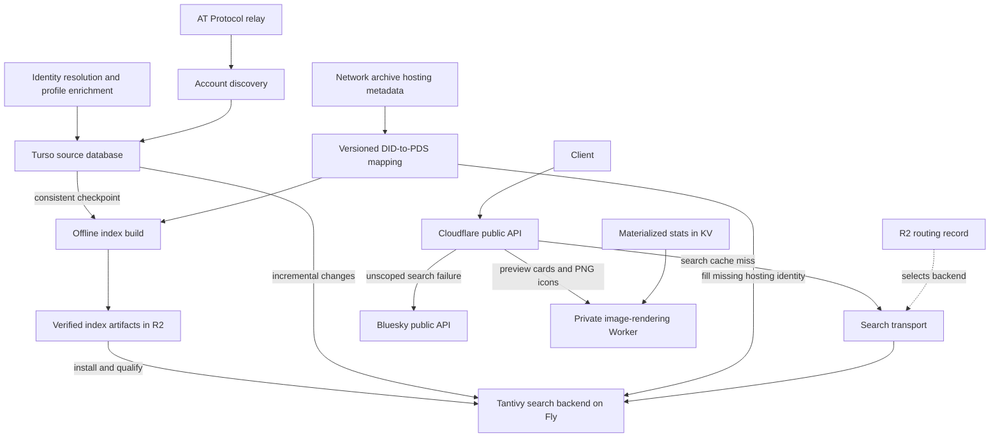

# Architecture

Typeahead provides account search and profile lookup for AT Protocol. People
and apps can find accounts by handle or display name and retrieve their public
profiles through the website or API, without signing in.

It watches the network for account changes and organizes that information into a
search index.
When someone types a name, the index finds matching accounts without contacting
each account's hosting server.

Changes flow into the index throughout the day. A separate build process also
makes fresh copies of the whole index. Each copy is checked before it can serve
searches, so building a new index does not interrupt the one people are using.

## Data flow

Boxes describe responsibilities and data, not a machine inventory. The same
backend runs both search and incremental index updates. Offline builds run
separately from the serving backend.

## Collecting account information

A Zig ingester follows the relay's `com.atproto.sync.subscribeRepos` firehose.
It records account activity and profile changes in Turso. Identity signals —
`#identity`, reactivated accounts, new accounts and PLC directory operations —
become durable rows in an identity queue in Turso; the ingester drains it,
resolving each handle and hosting server from the DID's authority. The ingester
also follows Bluesky's moderation labeler (`com.atproto.label.subscribeLabels`)
and records its labels on indexed accounts, committing the stream cursor with
each batch. Separate enrichment workflows fill in profile information.
Turso holds the actor records, ranking inputs and moderation state used to build
and update the index.

A PDS is an account's hosting server. Its identity cannot be inferred from the
account's handle: a custom-domain handle can be hosted anywhere. A versioned
DID-to-PDS mapping from the network archive supplements accounts whose source
PDS is empty. Nonempty source PDS values take precedence. The mapping is an input
to the index, not a bulk rewrite of the source database; a missing value in both
sources means the account cannot match a PDS filter.

## Answering a search

The public Cloudflare Worker validates parameters, applies rate limits and checks
its response cache. On a cache miss, a search transport reads the routing record
and sends the query to the selected Tantivy backend on Fly.

The transport relies on a route validated against R2 within the last second.
One Durable Object, `RouteAuthority`, holds that copy for every transport
isolate and re-reads R2 every 700 ms while searches have arrived in the last
five minutes, so a search usually takes the route from memory and R2 reads
are bounded by time rather than traffic. After 50 ms, the transport starts a
direct R2 read while still accepting a fresh authority response. The first
usable response wins; a losing read cannot overwrite the cache. An invalid or
failed authority starts the R2 read immediately, and a failed R2 fallback still
fails closed without waiting on a hung authority. Neither path extends the
route's one-second lifetime. Pending losing reads belong to `waitUntil`.
The object stays in the colo where it was first created, and each search waits
for a round trip to it, so it must be created by the transport (no location
hint). Check its colo with the `durableObjectsInvocationsAdaptiveGroups`
GraphQL dataset (`coloCode`); it should match the transport's. Serving from
more than one region is a [proposal](plans/worldwide-serving.md), not built.

Tantivy searches indexed handles and display names, ranks eligible matches and
returns stored actor profiles. Exact eligible handles have priority. Moderation
controls visibility independently of ranking. A PDS filter restricts candidates
before the result limit is applied, so it does not depend on finding that host's
accounts in an already truncated global result list.

The Worker exposes the public search aliases and profile-card endpoints, and
records request outcomes. Answers are unauthenticated and contain no
viewer-specific state. Parameter details, caching and response formats belong
in the [API documentation](https://typeahead.waow.tech/docs).

Image rendering uses a separate private Worker, reached through the public
Worker's `IMAGE_RENDERER` service binding. The existing `/og-image` and
`/apple-touch-icon.png` URLs, query parameters and cache headers are preserved.
Only the renderer imports `workers-og` and its Wasm modules; API and website
requests do not load them. The renderer reads the same materialized stats KV
namespace as the public Worker. The static web manifest stays in the public Worker.

## Keeping the index fresh

The backend polls source change keys and reconciles changed actors into Tantivy.
It commits index changes and source progress together so a restart can resume
from durable state. Profile changes, renames, deletions and policy updates do not
have to wait for a complete rebuild. The reconciler uses the same pinned hosting
mapping as the index builder, so an unrelated profile update does not erase a
joined PDS value.

Incremental progress and complete source coverage are different guarantees.
Polling can miss backdated changes or deletions outside its change window.
Consistent source checkpoints establish a known baseline; full reconciliation
can establish coverage only when a complete qualifying round finishes. Coverage
has an expiry bound, and a backend must not claim freshness merely because its
polling timestamp is recent.

## Building and publishing an index

Prefect orchestrates bulk work on disposable cloud compute. A build reads a
consistent Turso checkpoint, joins the pinned hosting mapping, constructs the
Tantivy index and publishes checksummed artifacts and metadata to R2. The offline
importer can be optimized independently; the pinned serving reader still validates
the built index and its live-source handoff before packaging and admission. Neither
the serving machine nor the public Worker performs this corpus-scale work.

The deployment controller installs the artifacts on an isolated backend with
independent storage. It checks artifact integrity, source coverage, search
behavior, update catch-up and restart behavior before conditionally changing
the routing record. A concurrent routing change prevents an older operation
from overwriting the newer decision.

The A/B deployment slots let preparation happen separately from serving. They
are roles that alternate, not a requirement to run two backends continuously.
Build cadence, resource allocations, rollback prerequisites and retention are
operating policies documented in the [refresh runbook](plans/automatic-snapshot-refresh.md),
not properties of the search engine.

## Handling failures

When the search backend fails, times out or returns an invalid answer, the public
Worker tries Bluesky for an unscoped search. These fallback answers are not cached;
a subsequent uncached request tries Typeahead again. A successful empty result
is a valid answer and does not trigger fallback.

PDS-scoped searches fail explicitly when their backend is unavailable because
Bluesky cannot honor the scope contract. If both services fail, the API returns
an error rather than a fabricated empty result. This fallback protects against
backend failures; it cannot protect against an outage of the public Worker itself.

Index artifacts and routing metadata are separate from the running process.
This allows installation, restart and deliberate rollback without rebuilding the
source database. Actual rollback targets, coverage deadlines and recovery steps
are recorded in [operations](operations.md).
