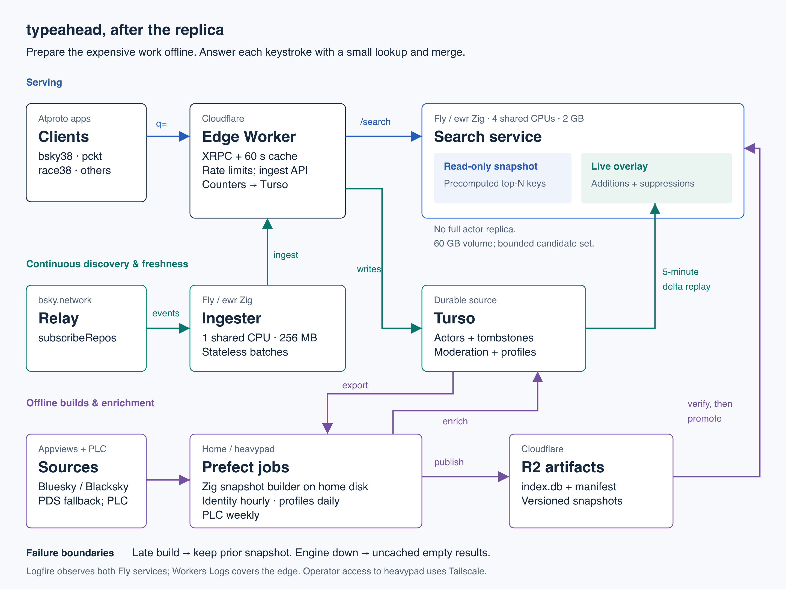

# architecture

Verified against the September 2 replica removal, September 4 fallback changes,
and live services on September 5, 2026.

`typeahead.waow.tech` provides independent actor search for atproto. The canonical
`tech.waow.typeahead.searchActors` endpoint and the
`app.bsky.actor.searchActorsTypeahead` compatibility alias share a handler and
60-second edge cache. Normal searches use our index. Bluesky remains an explicit
emergency rollback option.

[Explore the animated architecture](blog-assets/typeahead-sequel/interactive/architecture-embed.html): search, profile changes, and snapshot builds, with recorded query traces.

## serving

Clients reach the Cloudflare Worker, which applies rate limits, checks its edge
cache, and asks `typeahead-search` on Fly in `ewr` for `/search`. The Zig search
service holds a read-only SQLite snapshot and a live overlay. Since September 2
it has **no full actor replica, local FTS index, bootstrap/resync path, or replica
hydration safety belt**.

Each request normalizes the query, derives bounded prefix keys, reads
precomputed top-N DID lists, merges overlay additions and suppressions, promotes
exact-handle matches, and hydrates a capped candidate set from overlay first,
then snapshot actor blobs. Keys include exact handles (`e:`), handle prefixes
(`h:`), display-name tokens/CJK keys (`n:`), domain suffixes (`d:`), and DID lookup
support. Prefix keys are stored up to 16 bytes; a longer query looks up its cut
and the hydrated rows are filtered against the whole query (see
[the index design](typeahead-index-design.md#queries-longer-than-prefix_max)).
The active manifest specifies the index versions and caps. Union-prefix additions
use the partial overlay ranking index on `(key, score DESC, did ASC) WHERE op=1`
in this branch, avoiding a matching-prefix sort. Base corrections remain point
lookups; exact-key and intersection reads remain uncapped for correctness.

The serving invariant is about work per engine query: no actor-corpus scan or
request-time FTS ranking. It does not imply constant disk usage or a fixed RAM
requirement at arbitrary corpus sizes.

The Worker still writes request/traffic metrics to Turso. Thus engine search
reads are isolated from Turso, but the overall edge service is not database-free.
Profile lookup, admin operations, and request-indexing have their own paths.

## continuous ingest and freshness

`typeahead-ingester`, another role of the same Zig binary, consumes the relay's
`com.atproto.sync.subscribeRepos` firehose. It resolves identities and batches
updates through the Worker's admin ingest endpoint into Turso. It runs on Fly
with one shared CPU, 256 MB, and no persistent volume.

Turso/libSQL is the durable source of actor state, enrichment, moderation
overrides, and tombstones. The search service polls recent changes every five
minutes, starting from the greater of its persisted progress and the snapshot's
source watermark, with a 300-second overlap. It projects each page into the
overlay and persists progress per page.

To remove stale prefixes on a rename or moderation change, projection reads the
old served representation from overlay first, then snapshot. Reading a newer
replica row was not equivalent: it could miss the keys that serving still held.
Deletes and hides suppress base results; restores and new actors add candidates.
Compaction prunes covered rows in bounded chunks.

Request-indexing also sends the row just written to `/admin/refresh` on the
search service. This accelerates visibility without a second Turso read there;
periodic sync remains the recovery path if that push fails.

## offline builds and enrichment

Prefect's `home-pool` process worker on **heavypad** runs the snapshot builder.
`flows/typeahead_index.py` and `prefect.yaml` in `my-prefect-server` own deployment
and scheduling. The same Zig binary runs with `MODE=indexer`: export Turso,
build the prefix-index SQLite artifact, write its manifest, upload to R2, exit.
The schedule is `0 9 */3 * *` UTC: days 1, 4, 7, etc., with shorter intervals at
some month boundaries. `services/fly.indexer.toml` is a manual rollback option,
not the normal build host.

R2's `typeahead-index/latest.json` names the active `builds/<id>/index.db`.
Promotion checks manifest version, size, SHA-256, schema/index versions, and
sentinel queries before swapping the attached snapshot. A failed build or
validation keeps the previous snapshot serving. Base freshness still needs
monitoring; retaining an old snapshot indefinitely is not a healthy steady state.

Other heavypad jobs resolve identities hourly (:20 UTC), enrich profiles daily
(20:00 UTC), and process PLC identity data weekly (Monday 05:00 UTC). Profile
sources include Bluesky, Blacksky, and PDS fallback; PLC covers identity discovery
outside appview coverage. The Worker cron now handles freshness, stats, and
moderation refresh inside a 12-minute budget, without profile enrichment. Its
stats step materializes `stats_data` in KV (hourly snapshots, 5-minute search
metrics, per-app traffic at three grains, and the all-time app count); `/stats`
and the `/og-image` link-preview card read that blob, never Turso, for
corpus-scale figures.

Tailscale provides operator access to heavypad. Neither interactive searches nor
snapshot downloads traverse the home connection: clients use Cloudflare/Fly,
and Fly downloads the published artifact from R2.

## failure boundaries and recovery

Both Worker Turso search fallbacks are **off by default**:

- `TURSO_FALLBACK_ON_EMPTY=1` explicitly enables the empty-result fallback,
  subject to its small-limit guard.
- `TURSO_FALLBACK_ON_UNREACHABLE=1` explicitly enables engine-failure fallback.
  Normally, an unreachable engine returns `{actors: []}` **uncached**. This is
  degraded search, not full availability; it avoids flooding the shared writer.

These defaults followed September 4's burst, when fallback reads saturated
Turso and caused ingest backlog overflow. Request counters remain a shared-writer
coupling worth addressing.

A normal search restart re-adopts its validated on-disk snapshot and resumes
projection. A fresh volume must download a snapshot first. The September 2
cutover measured 20 minutes to attach plus 47 minutes to replay 19 hours of
changes; September 4's existing-volume restart took about 15 seconds. Neither
measurement is a general recovery-time guarantee.

Logfire receives Fly traces and logs; Cloudflare Workers Logs covers edge
failures. Check `/health/freshness`, ingest cursor advancement/backlog, Worker
errors, and Prefect completion together. Search readiness alone does not prove
new actors are being discovered. `/health/freshness` retains the legacy field
name `replica_lag_s`; it now measures overlay lag.

## observed deployment, September 5

- Search: one Fly machine, four shared CPUs, 2 GB RAM, 60 GB volume.
- Ingest: one Fly machine, one shared CPU, 256 MB, no volume.
- Snapshot: `b1788512492-0ed0`, 11,631,204 actors, 127,296,942 prefixes,
  14,027,964,416 bytes; R2 manifest and serving build agree.
- Latest build: September 4, 09:00–10:07 UTC, Prefect state `COMPLETED`.

For the incident and design history, see [operations](operations.md),
[replica removal](replica-removal-plan.md), and the
[September incident report](retros/2026-09-03-ingester-panic-hang-and-turso-saturation.md).

## PDS-scoped search (live October 20, 2026)

The builder counts actors by normalized hosting PDS offline, including
hidden and handle-less rows. It emits PDS-scoped prefix keys only for hosts at or
below `INDEX_PDS_MAX_ACTORS` (default 10,000); zero disables scoped lists.
`pds_scopes` records counts and eligibility. This is a build-time population
threshold, not a live membership quota.
Scoped searches use these lists before merge and hydration; filtering global top-N
results would lose community actors below the network-wide cutoff. No second
actor blob is stored. Overlay projection diffs the previous and current hosting
PDS alongside handle/name, suppressing old memberships on migration. Hydration
checks the current PDS again to avoid leaking stale membership. Live projection
also consults eligibility and emits no scoped keys for excluded PDSs.

The snapshot hashes its eligible-host set. When that policy changes, scoped
search returns 503 until sync has replayed from the snapshot watermark and stored
the matching policy hash. Otherwise a newly eligible host could miss actors
updated after the snapshot but before promotion. Unscoped search remains available.
A failed replay leaves the gate closed; normal sync resumes after a successful pass.

The existing lookup bounds and multi-token intersection limitations remain.
The full-corpus compact release passed paired correctness/performance, replay,
rollback and restoration gates before deployment; see
[the release evidence](evals/pds-homepage-20261020.md) and
[current configuration and rollback](plans/pds-homepage-rollout.md).
