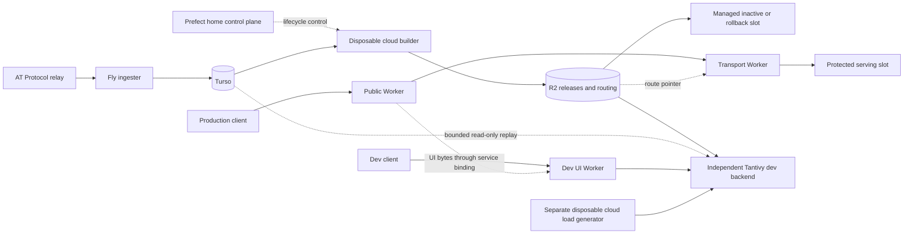

# Typeahead topology and dev isolation

Initial inventory captured October 28, 2026; deployed dev state updated October 29.
The raw receipts omit credential values and retain machine identity/configuration.

| Component | Current role | Mutation boundary for this work |
| --- | --- | --- |
| Cloudflare public Worker, typeahead.waow.tech | API aliases, cache, admin ingestion, edge behavior | No deployment or routing changes |
| Cloudflare typeahead-search-transport | Stable search origin; reads R2 routing control | Read-only route guard |
| Fly typeahead-startup-20261024 /8e3d79b70dd748 | Serving build b1793109259-2b36-px05,2 shared CPUs/1GiB, independent disk | Protected; no restart, resize, clone or workload trial |
| Fly typeahead-search-refresh /801539a6551778 | Retained rollback build b1793081565-0228-px05,2 shared CPUs/1GiB, independent disk | Protected; no mutation |
| Fly typeahead-ingester /7845636a3d0ee8 | Relay firehose ingestion into Turso,1 shared CPU/256MiB | Protected; no mutation |
| Turso Typeahead database | Authoritative actor/profile/score/PDS changes and tombstones | Fixed bounded SELECT-only replay; no writes |
| R2 immutable releases and control objects | Snapshot corpus and managed routing/publication metadata | Read immutable release objects; no writes |
| Prefect home API/worker | Control plane for disposable cloud builders | No calls, runs or configuration changes required here |
| Disposable Hetzner builders, typeahead-ephemeral | Source-to-R2 offline refresh work | No active VM in the inspected project; not used for dev bootstrap |
| Fly typeahead-tantivy-dev /840e95a2153308 | Public Tantivy service, two shared CPUs/1 GiB, independent 40 GiB volume vol_4oj6mqjpnlgeyqxr, durable replay cursor | Only owned dev resources may change |
| Cloudflare typeahead-tantivy-dev-ui | Deployed production UI through service binding; API/XRPC requests target dev Tantivy | Separate dev Worker; no production Worker deployment or route change |
| Disposable Fly load generator | Separate shared CPU/256 MiB, no volume or public service; bounded load against dev HTTPS | Destroyed after qualification; `lifecycle-final.json` |

The other existing Typeahead Fly apps have no machines/volumes at this inventory:
typeahead-backfill,typeahead-canary,typeahead-indexer,typeahead-refresh-handles,
typeahead-search and typeahead-search-compact. They are not alternate active
serving slots and will not be revived.

No corpus route passes through the laptop or HeavyPad. Only source code,
immutable artifact metadata, read capabilities, hashes and bounded result
receipts cross the operator connection. The dev importer uses the current
serving generation's immutable R2 objects; it never reads serving/rollback disks.
The dev source manifest is12,816,605actors and7,331,160,064prefix-artifact bytes.
Data transfer, validation, export, indexing and replay occur on the dev cloud VM.

The hosted Prefect connector requires reauthentication. Local deployment and
migration files establish the recorded cloud-builder ownership, and provider
inventory confirms no active builder; scheduler/worker heartbeats were not
queried through the home API. No claim of a live scheduler qualification is made.

Protected identities and the production route are captured in inventory-before.json,
hetzner-before.json and route-before.json. Recheck them around provisioning and
qualification. The final `protected-latest.json` comparison reports all three
protected machines and the production route unchanged. Legitimate existing refresh activity is reported rather than
mistaken for a dev action; the new app is never registered as a managed route.

The public dev endpoints are https://typeahead-tantivy-dev.fly.dev and
https://typeahead-tantivy-dev-ui.n8-3e9.workers.dev. Image digest
`5342a3b41539777658b2a5e8a64935593ee82a6609f4798e2f12da5bc91d48ec`
is deployed on the admitted index. The UI response is byte-identical to the deployed
production homepage; [HTTP verification](ui-verification.json) covers dev health,
search and XRPC alias equivalence. This is HTTP verification without visual QA.
The private authenticated admin listener remains on loopback port 8081; public
search is on port 8080. Turso replay performs fixed SELECTs only and commits its
cursor with index changes. It neither mutates source records nor publishes a
managed production route.

Final cleanup retained exactly the owned dev service and its independent volume.
The load helper is absent, temporary source payloads are removed, telemetry is
stopped and the temporary controller credential is revoked/deleted. See
[lifecycle](lifecycle-final.json) and [controller cleanup](controller-cleanup.json).
