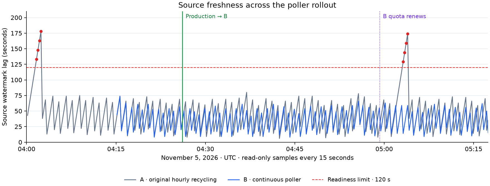

# Hourly source-poller readiness failures

Status: November 5, 2026, 05:17 UTC. The fix is live on B. Managed qualification,
cached restart, guarded promotion, authenticated smoke, ranking acceptance and
the first hourly-boundary observation passed. The matching refresh proof is
registered live for the next 06:00 UTC run.
Times below are UTC.

## Failure

The November 5 03:00 freshness alert reported `search service not ready`, roughly
two minutes of replica lag and a nine-hour snapshot. Coverage was valid and the
latest scheduled refresh had completed. The serving reader had not restarted.
Fly recorded repeated readiness failures:

| failure | recovery |
| --- | --- |
| Nov 4 20:51:25 | 20:51:40 |
| Nov 4 21:52:42 | 21:53:12 |
| Nov 4 22:54:29 | 22:54:43 |
| Nov 4 23:56:06 | 23:56:21 |
| Nov 5 00:57:11 | 00:57:42 |
| Nov 5 01:58:57 | 01:59:27 |
| Nov 5 03:00:58 | 03:01:43 |
| Nov 5 03:02:43 | 03:02:58 |
| Nov 5 04:01:33 | 04:02:34 |

The source process exits on a 3,600-second SIGALRM. Its supervisor restarts it,
and every startup checks the entire 1.4 GB immutable PDS mapping again. Source
logs contain seven corresponding process-deadline errors. The latest process
started at 02:59:05; its first completed catch-up targeted 03:00:29. Process I/O
counters showed 1,504,616,448 bytes read from disk. These observations establish
the startup gap and repeated file read; they do not separately time hashing,
source HTTP or individual commits.

An interrupted cycle resumes its durable cutoff. Catch-up can span bounded
cycles, with a 40-second sleep after each, leaving the watermark older than the
reader's 120-second readiness limit even after polling resumes. The restart
cadence and resulting lag explain the recurring failures; a candidate observation
past the former hourly deadline remains the production-scale verification gate.

### Direct observation of the next natural restart

The [baseline file-offset samples](baseline-file-reads.jsonl) watched the
existing restart without causing one. PID 3471 exited; PID 6887 started at
04:00:37.3. Its checksum descriptor was still advancing after 78.7 seconds;
the read-only SQLite connection was open at 88.7 seconds. Source budget counters
stayed unchanged during the scan. This directly locates the pause before source
HTTP work, rather than attributing it to Cloudflare or the probe client.

[Health and fallback samples](natural-failure.jsonl) observed lag increase from
73 to 178 seconds. Fly marked readiness failed at 04:01:33 and passing at
04:02:34. Both public aliases returned 200 with one actor and
`X-Typeahead-Engine: bluesky`, `X-Typeahead-Failover: automatic`; the scoped
request returned 503 `PdsScopeUnavailable`. The
[recovery check](natural-recovery.json) verified Tantivy on A again, byte-identical
aliases and a successful request scoped to the actor's actual PDS. The reader
machine and version stayed unchanged throughout.

The candidate's first poller also spent about 88 seconds before creating its
source budget. At 28 seconds it had read 471 MB from disk while using 0.87 CPU
seconds; [after startup](candidate-first-poll.json), disk reads totaled 1.49 GB.
The [initial process sample](candidate-first-start.json) records the real
`--max-run-seconds 0` command and 24.6 MB RSS during hashing.

## Change and release scope

`6cc486e` permits `--max-run-seconds 0` only with a durable hourly budget.
`7d20aa1` selects it in the managed slot. Budget rollover already happens inside
the durable source client; process recycling is unnecessary. The 512 MiB hourly
ceiling, 128 MiB polling reserve, HTTP/cycle/sweep bounds, startup checksum and
120-second readiness limit remain unchanged.

The [release Dockerfile](Dockerfile) layers only the new `sync.py` and the single
slot argument change onto the deployed immutable image. The slot script is
`c476fc5` with that argument changed, rather than the complete current slot tree.
This release does not include the separately pending coverage-expiry or native
provenance changes. The [package manifest](package.json) and
[installed file hashes](image-files.json) bind the payload. The reader remains
`ef2be085f7ad7b2bf4ea1f0e4976ee07e37b4041a95b5f34c31c562399f17a4d`.
Run `uv run --no-project docs/ops/poller-readiness-20261104/prepare-image.py <new-directory>`
from this repository to reproduce the small build context, then build its
Dockerfile for `linux/amd64`.

Candidate image:
`registry.fly.io/typeahead-tantivy-b@sha256:bc66ce9eec3aca5d568135e6d0637f2e2be6e0c305095fc29e4fd50c15d0d34d`.
The managed [preparation run](https://prefect-server.waow.tech/runs/flow-run/4b0c50b9-dd80-4162-9d58-2d7049aed5f4)
installs the existing immutable build `b1793815407-cp-1f545dd4aa` on inactive B,
machine `812056a97999d8`, independent 20 GiB volume `vol_4581g37oj08kxn94`.
The controller owns preparation and cleanup. A remains untouched and retains
valid coverage until November 5 18:03:27. The next scheduled refresh is 06:00 UTC;
finish promotion and persist the new release proof before that run, or reconcile
the manual candidate so it does not fence refresh.

Preparation completed at 04:15:04 with
[plan `6ae0d762…`](plan.json). The [journal](preparation.json) records both
first-start and cached-restart qualification. [Release proof](release-proof.json)
`2cb383df761467c5d7afcb374e9baa01e040faf35170d78b518ac655d3e6b4ba`
and its six evidence objects were uploaded immutably and read back; see the
[publication receipt](release-publication.json). At publication, the proof left
the first hourly boundary under observation; the supplemental verification below
closes that limit. The qualified candidate was
promoted before that boundary to avoid another known serving failure; A remains
available for rollback and comparison. The bounded observation covered more than
an hour after cached-restart qualification.

The [paired warm-engine check](matched-performance.json) matched all 39 response
pairs byte-for-byte, including a PDS filter. In the 26 measured queries per
backend, A's median was 2.771 ms and B's was 1.867 ms; sampled p95 was 3.203 ms
and 2.193 ms respectively. These are small engine cohorts, not end-to-end user
percentiles. The first comparison invocation mistakenly expected the scope
acknowledgment to echo an origin URL; the actual contract acknowledges the
canonical hostname. The corrected check passed without changing the service
or the performance acceptance bounds.

## Production cutover

The [guarded promotion](https://prefect-server.waow.tech/runs/flow-run/45b9f7c6-a45e-4571-8f85-41657f123221)
completed at 04:26:08. The route selects B with admission
`8216daf108e7dbc4ae6bbe24ca14b056620f5bb88211dd245416a8ea7905dc03`
and retains A as previous. [Promotion parameters](promote-params.json) bind the
reviewed plan, exact prior ETag and new release proof.

The [public canary](public-after-promotion.json) verified both aliases and a
PDS-scoped search on machine `812056a97999d8`, with byte-identical alias bodies.
Freshness reported healthy source lag of 16 seconds. The
[authenticated smoke](authenticated-production-smoke.log) passed 62 checks,
including admin CRUD; only the optional Bluesky comparison was skipped. The
[ranking run](production-ranking.log) passed all acceptance criteria. The
[routed index status](production-index-status.json) confirms the expected build,
binary, machine, full corpus and strict freshness configuration. No claim is
made that this small cohort establishes an end-to-end latency percentile.

MPS main `3cd4bcf` pins the matching release proof for the next automatic refresh.
CI passed, and the trusted HeavyPad registrar applied that exact main revision;
[live readback](registration.json) confirms the matching proof at 04:48 UTC.
The [queued runs](next-refresh.json) start at 06:00 and 18:00 UTC with
`automatic_refresh:true` and no stale per-run job overrides. The publisher code,
06:00/18:00 cadence and checkpoint coverage anchor are unchanged; this image-only
cutover did not renew the snapshot's lifetime.

## Hourly-boundary verification

The [verification report](verification.json) covers 250 direct readiness samples
over 3,736 seconds (62 minutes), with zero readiness failures and zero unknown
results. Maximum source lag was 74 seconds under the unchanged 120-second limit.
The [raw observations](observations.jsonl) retain the preparation and old-control
failures separately; the qualified B cohort starts after 04:15:05.

PID 653 remained the same process, with the same start time and arguments,
through both quota renewal and the former hourly process deadline. Its ledger
renewed from the 03:59:13 window to the 04:59:14 window while polling continued.
[Before renewal](budget-before-renewal.json), 222,145,638 bytes were charged;
[after renewal](budget-after-renewal.json), the new window had charged 9,510,776
bytes. The 512 MiB ceiling was unchanged. The
[ending process sample](candidate-soak-end.json) and
[backend status](candidate-status-end.json) confirm the continuing process and
strict freshness configuration.

Retained A failed readiness again around 05:03 while B stayed healthy. The
[control witness](control-failure-witness.json) and
[simultaneous public checks](public-during-control-failure.json) verified both
aliases and PDS scope returning 200 from B while A was unready. The
[final public check](public-final.json) also passed with byte-identical aliases.

The completed report was [published and read back](verification-publication.json)
as `control/tantivy-release-evidence/be77b367294724e6cc06249faa30000dfbf87609b1cbb21df838188b9e3caddd.json`,
bound to the same image and release proof. This resolves the original proof's
publication-time hourly-observation limitation. Fifteen-second sampling and one
observed renewal are evidence for this fix, not a universal availability or
request-latency SLO.

Test commit `19a55c6` extends the real CLI / TLS / SQLite / Rust regression across
a real quota deadline, then verifies a later actor change after renewal. The
ledger is an aging fixture window; the production 3,600-second duration is
unchanged. The seven-test host suite passed, including per-commit execution via
`git rebase -x`; the [exact release-image regression](quota-boundary-regression.log)
passed in 25.2 seconds at two CPUs / 1 GiB. No production code changed in that
test follow-up.

## Verification

Both commits passed the source pacing, durable budget and slot suites separately
through `git rebase -x`. All three Tangled workflows passed at `7d20aa1`.

At two CPUs / 1 GiB, the Linux release image passed the continuous-polling TLS /
SQLite / real-Tantivy regression and the existing adapter suites (37 tests),
[source/policy/crash integration](source-receipt.json),
[15 functional checks](functional.json), and the exact packaged
[slot integration](slot-integration.log) (10 passed, one optional test skipped).
The slot integration exercised actual source polling and restart with the same
persisted hourly budget. One initial integration invocation used a non-executable
tmpfs and failed while executing a copied fixture binary; it passed after the
scratch mount permitted execution. [Test cleanup](test-cleanup.json) verifies
the containers and anonymous fixture volume are gone.

README review: the public interface, architecture and development entry points
are unchanged. The source adapter README documents continuous mode; deployment
state and incident evidence belong here and in operations.

## Cleanup and ownership

Codex owned `/tmp/typeahead-readiness-20261104` with a 5 MiB metadata-only budget.
No full corpus or index was copied to the laptop. The managed controller owned
the independent 20 GiB candidate disk; B is now serving and A is the retained
rollback slot. Both temporary controller VMs were deleted after their runs.
[Final cleanup](final-cleanup.json) confirms the bounded local observers stopped
and all four test containers are absent; the earlier anonymous fixture volume
was also removed. Temporary baseline test-source extraction was retired, while
small scripts, manifests, hashes and results remain.
