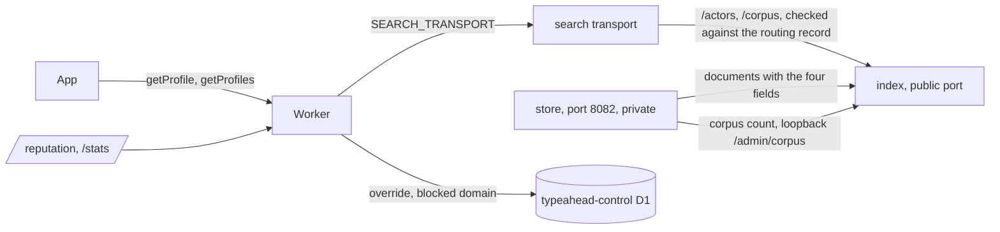

# Turso retirement

Status, 2026-11-12: built and tested locally on the `turso-reads` branch.
Nothing here is deployed: no slot serves `/actors` or `/corpus`, the transport
does not forward them, and the Worker has no `PROFILE_MODE`, `CORPUS_MODE` or
`TURSO_ACTORS`. The [rollout](#rollout) below has not been run, and none of its
commands has been run against production.

Search has been answered by store slots since 2026-11-11. They follow the relay
themselves and keep the corpus on their own disk, and they never read Turso.
The Worker still reads and writes Turso for everything else it does with an
actor. This is what remains, where each piece goes, and the order in which
Turso, the old ingester and the two HeavyPad flows that keep Turso fresh can be
stopped.

Statistics (requests, traffic, the `snapshots` table, `/source-icon`'s
known-source check) leave Turso separately, under `STATS_MODE` on the
`stats-d1-read` branch ([plan](plans/stats-off-turso.md)). Moderation policy and
indexing requests already have their source of truth in the control database
([slot control](slot-control.md)).

## What still touches Turso

Every use of the Turso client in `src/` on 2026-11-12, by feature. "Replacement"
is one of: **slot**, the routed store slot through the search engine's public
port; **D1**; or **delete**, with what shows nothing else needs it.

| feature | what it does in Turso | who calls it | replacement | switch |
|---|---|---|---|---|
| `GET /xrpc/app.bsky.actor.getProfiles`, `getProfile` | reads 15 columns of `actors` by DID or handle, `hidden = 0` | public apps; answers are edge-cached 300 s | slot: `/actors` | `PROFILE_MODE` |
| `GET /debug/reputation` | reads one `actors` row, its `mod_overrides` row, the `blocked_domains` row that applies, and the visible actor with the same handle; for a never-checked actor it claims the row and upserts a fresh appview profile | the `/reputation` page | slot: `/actors` for the actor and the handle lookup. D1: the override and blocked domain from the control database. Delete: the on-view refresh, because a slot refreshes profiles on its own schedule and `/request-indexing` is the on-demand path | `PROFILE_MODE` |
| `/stats` "actors indexed", handle and avatar shares | hourly: `counters.actors_total` and three `COUNT`s over `actors` | cron | slot: `/corpus`, the store's own corpus scan | `CORPUS_MODE` |
| `/stats` "hidden by policy", "invalid identity" | daily: every hidden `actors` row, `mod_overrides`, `blocked_domains`, two handle counts | cron | slot: `/corpus`, counted by the index | `CORPUS_MODE` |
| Turso policy mirror (`src/turso-policy-mirror.ts`) | after the control write, the admin override and domain-block handlers write `mod_overrides`, `blocked_domains` and `actors.hidden`, with rowid-window backfills; `DELETE /admin/mod-override` reads the row to answer `hidden` | operator | delete: only the Turso-fed slots read these. The `hidden` in the delete answer comes from the slot's copy of the account | `TURSO_ACTORS` |
| `/request-indexing` | upserts the requested actor; reads policy from Turso when the control database fails | public users (homepage button) | delete: the request is already logged in the control database and slots index from their own sources | `TURSO_ACTORS` |
| `POST /admin/delete` | deletes `actors` rows, writes `tombstones` | the old ingester (`services/src/ingest.zig`); `scripts/backfill-plc.py` (the retired PLC job), `scripts/reconcile-inactive-recovery.py`; an operator, per [private directories](private-directories.md) | delete: a slot removes an account when the relay reports it gone. The operator's remedy for an account that should not be listed is a `hide` override and a domain block, both in the control database | `TURSO_ACTORS` (410) |
| `POST /admin/enrich-profiles` | upserts appview profiles into `actors` | `scripts/prioritized-enrich.py` (`just enrich-plan --apply`), `scripts/refresh-recovery-profiles.py`, `scripts/reconcile-ingest-recovery.py`, and the reputation page's on-view refresh | delete: the store role refreshes profiles itself (`services/src/store_process/enrich.zig`) | `TURSO_ACTORS` (410) |
| `POST /admin/ingest` | inserts and updates `actors`, enqueues `identity_queue` | the old ingester; `scripts/backfill-plc.py`, `scripts/reconcile-ingest-recovery.py` | delete | `TURSO_ACTORS` (410) |
| `/admin/identity/lease`, `/complete`, `/plc`, `/status` | leases and settles `identity_queue`, writes `actors` identity | the old ingester | delete | `TURSO_ACTORS` (410) |
| `/admin/labels`, `/labels/reconcile`, `/labels/cursor` | writes `account_labels`, `actors.labels` and `hidden`; `counters.label_stream_seq` is the label stream's cursor | the old ingester's label tail | delete: a store slot keeps its own label cursor with its data | `TURSO_ACTORS` (410) |
| cron `refreshModeration` | walks `actors` by quality and by the refresh queue, rewrites labels, hidden and counts, deletes dead accounts | cron | delete: the store role's enrichment walks do this | `TURSO_ACTORS` |
| search fallback to Turso, and the Bluesky backfill behind it | three `actors` and `actors_fts` reads when the engine answers empty | public search, only when `TURSO_FALLBACK_ON_EMPTY=1` | delete: off since 2026-09-04. `TURSO_FALLBACK_ON_UNREACHABLE` is declared and nothing reads it | `TURSO_ACTORS` |
| `actor_deltas` tail on the `/stats` chart | written by `/admin/ingest`, `/admin/delete` and the cron's deletions; stitched after the last hourly snapshot | cron and ingester | delete: it stops with its writers, and the chart then ends at the last hourly snapshot | none |
| statistics tables, `/stats` tail, `/source-icon` | `request_buckets`, `metrics`, `traffic_*`, `snapshots`, rollups | every request, cron | D1 | `STATS_MODE`, on `stats-d1-read` |

Outside the Worker, and not changed here:

- **Deploy tooling.** `just deploy-worker` runs `just control-ready`, which
  compares the control database with Turso and needs the Turso variables.
  `just control-check` and `control-served-check` do the same. `scripts/smoke.py`
  has two `EXPLAIN` checks against Turso that are skipped without the variables.
  `just enrich-plan`, `just cleanup` and the recovery scripts read Turso
  directly. All of these go in the last step.
- **Readers of Turso that are not the Worker.** The Turso-fed slots
  `typeahead-tantivy-a` and `-b` poll it every 40 s, and the twice-daily
  `typeahead-index` build exports it. They are the rollback target while the
  routing record's `previous` names one
  ([store slot operations](ops/store-slot-operations.md#what-must-keep-running-for-a-rollback-to-a-managed-slot)).
- **Writers of Turso that are not the Worker.** The HeavyPad flows
  `typeahead-identity-hourly` and `typeahead-enrich-backfill` in
  my-prefect-server write it directly. They call no Worker endpoint.

What "delete" rests on, for the rows where nothing replaces the feature:

- No page calls `/admin/*`: `grep -n "admin/" src/pages/*.ts` finds only the
  endpoint labels on `/stats`. The homepage calls search and
  `/request-indexing`, the reputation page `/debug/reputation` and search.
- `/docs`, `/llms.txt` and the README document search, `getProfile`,
  `getProfiles` and `/request-indexing`, none of the endpoints deleted.
- `scripts/smoke.py` exercises `/admin/mod-override` and `/admin/mod-overrides`
  only, of the admin endpoints.
- The Zig callers (`ingest.zig`, `identity.zig`, `label_tail.zig`,
  `plc_tail.zig`) are the ingester role, `MODE=ingester`. The store role opens
  no connection to these endpoints.

## What a slot's document did not hold

`getProfiles` returns fourteen fields. The index document held what search
returns and the three counts. Four things were missing, and the store holds all
of them:

| response field | from | was it in the document | now |
|---|---|---|---|
| `did`, `handle`, `displayName`, `avatar`, `avatarFallback`, `associated`, `labels`, `createdAt` | `did`, `handle`, `display_name`, `avatar_url`, `pds`, `associated`, `labels`, `created_at` | yes | unchanged |
| `followersCount`, `followsCount`, `postsCount` | the three counts | yes | unchanged |
| whether the counts are shown at all | Turso: `profile_checked_at > 0` or any count above 0 | no | `profile_checked`, a flag |
| `description` | `description` | no | `description` |
| `banner` | `banner_url` | no | `banner_url` |
| `indexedAt` | `updated_at` | no | `updated_at`: the second the store last changed the actor's content |

What it took:

- **The document** (`services/tantivy/src/actor.rs`) gained the four fields.
  Each is written only when set, so a document stored before they existed
  serializes and hashes exactly as it did: no format change, and nothing is
  rewritten until its source sends one of them.
- **The bridge** (`services/src/bridge/`) sends them from the store's record.
  `updated_at` moves only when the content changes, which also logs a change.
  `profile_checked_at` moves on every refresh without a log entry, so the
  bridge sends whether it was ever set, not when: sending the time would make
  each resync rewrite documents that no log entry announced.
- **Documents already in an index** gain the fields when their actor next
  changes, or in a full resync round. `INDEX_RESYNC_AFTER` (Unix seconds) asks
  the bridge for one such round: it starts once the clock has reached that time
  if the last completed round started before it. The round's progress and start
  time are in the committed cursor as they always were, so a restart neither
  repeats nor loses it, and an image that does not know the setting reads the
  same cursor. A round rewrites every document 500 at a time; how long it takes
  on a slot was not measured.

One edge: an account whose first appview read changes nothing else (no display
name, no avatar, all three counts zero) sets the flag without a change-log
entry, so its document says "not read" until the account next changes or a
resync runs. The only effect is that three zero counts are left out of its
profile.

## Profile fill

Status, 2026-11-12: built and tested locally on the `profile-fill` branch.
Nothing here is deployed, the endpoint has not been called against production
Turso, and no slot has run the pass.

A store slot was loaded from a search-index bundle, and a bundle carries no
`description` and no `banner`. So a slot's store holds those two fields only
for the accounts it has refreshed from the appview since its load, and
`getProfiles` in slot mode would return the rest without them. Turso's
`actors` table has both for every account. Re-reading every profile from
Bluesky is about a million requests and is ruled out. The profile fill copies
them from Turso once per store, before Turso goes.

**The Worker** serves them at `GET /slot/control/profile-fill?after=<row>&limit=<n>`,
beside the [slot control endpoints](slot-control.md#endpoints) and behind the
same `SLOT_CONTROL_SECRET` (`src/handlers/slot-control.ts`). A call reads the
next `limit` rows of `actors` in the order the table is stored (1 to 1000,
default 500) with

```sql
SELECT rowid, did, description, banner_url FROM actors WHERE rowid > ?1 ORDER BY rowid LIMIT ?2
```

and answers `{"rows":[{"did","description","banner"}],"next":"<row>"|null}`:
the rows read that have a description or a banner, and the last row number read,
which is the next call's `after`. `next` moves on when no row of the page
qualified and is null once the table has ended (a page shorter than `limit`).
`banner` is the blob's CID, the form a store record holds; Turso's
`banner_url` holds a CID, a CDN URL or a getBlob URL, and the handler reduces
all three. The query is a range search of the table by rowid (`SEARCH actors
USING INTEGER PRIMARY KEY (rowid>?)`, pinned with bound parameters by
`src/handlers/slot-profile-fill.test.ts` on the production schema dump), so a
call reads `limit` rows that lie next to each other. Paged by DID a call was
`limit` index entries and `limit` lookups scattered through the table, 2.8 s
a page on 2026-11-12. It answers `400` for an `after` that is not a row number or a
`limit` out of range, `401`, `429` and `503` as the other slot endpoints do,
and `410` once `TURSO_ACTORS` is `off`.

**The store role** runs the pass when `PROFILE_FILL=1` and the control loop is
on (`services/src/store_process/profile_fill.zig`). It asks for the page after
its stored position and hands it to the owner, which applies it and stores
the new position in one commit (`Store.profileFill`), so a restart resumes
where the last commit left it. For each row whose actor the store holds and
that is live:

- the description is written if the stored one is empty, and the banner
  likewise. A stored value is never replaced, so what the slot's own refreshes
  wrote wins;
- nothing else is written: not the check time, the profile source, the
  counts, the score, the handle or the labels, and no refresh or identity
  entry is queued. `updated_at` moves, as for any content change, so
  `indexedAt` for a filled account is the time of the fill;
- the actor goes into the change log, and the index bridge sends the two
  fields to its document.

An account Turso holds and the slot does not is passed over, and so is one the
slot holds as gone. The pass makes no request to Bluesky.

When the Worker answers `next: null` the store records `finished_at`, the loop
ends, and no later process asks again for that store, whatever `PROFILE_FILL`
says. A store bootstrapped afresh starts its own pass.

| variable | default | meaning |
|---|---|---|
| `PROFILE_FILL` | unset | `1` runs the pass. It needs `CONTROL_URL` and `SLOT_CONTROL_SECRET`; without them it stays off and `/health` says `profile_fill.state: "misconfigured"` |
| `PROFILE_FILL_PAGE` | 500 | rows of Turso's table one page reads, 1 to 1000 |
| `PROFILE_FILL_STEP_SECONDS` | 1 | seconds between pages, 0 to 3600; 0 asks for the next page as soon as one commits, and a page deferred for bridge lag still rests 1 s |
| `PROFILE_FILL_LAG_LIMIT` | 50000 | no page is asked for while the index bridge is more than this many change-log entries behind (`change_log.head` less `cursors.bridge`) |

**What a pass costs.** Turso held about 13.2 million actors on 2026-11-12.

- 13,200,000 rows / 500 a page = 26,400 pages, and 26,400 requests to the
  Worker, for one slot; 52,800 for both.
- 26,400 pages x 1 s = 26,400 s = 7 h 20 min of rests. Each page also takes
  its request and its commit, which were not measured, and every step skipped
  for bridge lag adds a second, so this is the least a pass takes.
- 13.2 million rows read from Turso for one slot, 26.4 million for both; twice
  that if Turso counts the index entry and the row separately. The plan allows
  100,000 million a month ([usage](turso-usage-analytics.md)).
- One change-log entry and one index document rewrite for each actor filled.
  A page can fill up to 500, so the lag limit is what keeps the pass from
  outrunning the bridge; how many actors Turso holds a description or a banner
  for was not counted.

A page that cannot be had (no answer, `401`, any other status, a body whose
DIDs do not rise from the position asked from) is counted, changes nothing and
is asked for again after 30 to 36 s.

**Running it on one slot.** It needs the [slot control rollout](slot-control.md#rollout)
finished for that slot (the Worker serves `/slot/control/*` and the slot holds
the secret), a deployed Worker that has this endpoint, and `TURSO_ACTORS` not
`off`. Run it on the standby first.

```sh
curl -s -H "Authorization: Bearer $SLOT_CONTROL_SECRET" 'https://typeahead.waow.tech/slot/control/profile-fill?limit=2' | jq '{rows: (.rows | length), next}'
fly deploy . --config deploy/shadow-slot/fly.toml -a <slot> -e PROFILE_FILL=1
fly ssh console -a <slot> -C "curl -s localhost:8082/health" | jq .profile_fill
```

A deploy restarts the machine: see
[what a store restart costs](../../deploy/shadow-slot/sizing.md#what-a-store-restart-costs-the-watermark).
While it runs, `state` is `on`, `pages` and `position` (a row number of Turso's table) rise (the stored
figures are refreshed once a minute), `failures.total` stays 0, and `deferred`
rises only while `bridge_lag` is above the limit. It is done when `finished`
is true and `finished_at` is set; `filled` is the number of actors that took a
field. Then check a profile the slot had not refreshed:

```sh
curl -s 'https://<slot>.fly.dev/actors?actor=<a handle>' | jq '.actors[0] | {description, banner_url}'
just profile-check 2000 https://<slot>.fly.dev
```

`profile-check`'s `fields` should no longer list `description` or `banner`
beyond what the two stores' refresh schedules explain. The variable can stay
or go with the next deploy; a finished store ignores it. To stop a pass midway,
deploy without `PROFILE_FILL`: the position is kept, and setting it again
resumes.

The heartbeat span carries `profile_fill_pages`, `profile_fill_rows`,
`profile_fill_filled`, `profile_fill_finished_at`, `profile_fill_failures`,
`profile_fill_deferred`, `profile_fill_bridge_lag` and
`profile_fill_misconfigured`.

## What is built



**On the slot, the index's public listener** (`services/tantivy/src/server.rs`,
`engine/read.rs`):

| request | answer |
|---|---|
| `GET /actors?actor=<did or handle>`, the parameter up to 25 times | `200 {"actors":[…]}`: for each name the index has a live document for, the stored fields under their stored names (`did`, `handle`, `display_name`, `avatar_url`, `labels`, `created_at`, `associated`, `pds`, `description`, `banner_url`, the three counts, `quality_score`, `updated_at`, `profile_checked`), `hidden` (the moderation decision a search would make now) and `hidden_stored`. In the order asked for, each actor once. A handle matches without regard to ASCII case; two accounts that claim one handle are both returned |
| `GET /corpus` | `200 {"index":{"actors","searchable","handle_invalid","quarantined","watermark"},"store":{"live","total","with_handles","with_avatars","hidden","scanned_at"} or null}`. `index` is counted by the index and kept for 60 s. `store` is the store's last corpus scan, null until the store has reported one |

Both answer `400` for no actor, more than 25, or a name over 2,048 bytes, and
`503` while the index is not ready, as search does. Both carry the
`X-Typeahead-*` identity headers. There is no credential: these are reads on
the port search is already served from, and the transport is what binds an
answer to the routed slot.

`/actors` returns hidden actors, marked. Everything in a document is a public
record, and `/debug/reputation` on the Worker has always reported hidden
accounts by handle. The Worker leaves hidden actors out of `getProfiles`.

**The store's port stays private.** The corpus count the statistics page needs
is taken by the store's scanner (`corpus.zig`), which only the store's port
reported. A reporter thread in the store role
(`index_bridge.zig`, `CorpusReporter`) posts the last count to the index's
loopback admin listener, `POST /admin/corpus`, every 60 s with the index's own
admin secret. The index keeps it in memory, so after an index restart `store`
is null for at most a minute once the store has a count. A slot holds no new
credential, and nothing new listens.

**The transport** (`src/search-route.ts`) forwards `/actors` and `/corpus` like
its other read paths: to the origin the routing record names, refusing an
answer whose build, format, binary or strategy headers differ from the record.

**The Worker** reads the slot through `src/slot-read.ts`, over the
`SEARCH_TRANSPORT` binding, and parses the answer at that boundary. Three
variables decide what it does. Each takes effect on a deploy and is undone by
deploying the previous value.

| variable | values | what changes |
|---|---|---|
| `PROFILE_MODE` | `turso` (default, and any unknown value), `compare`, `slot` | `getProfiles`, `getProfile`, `/debug/reputation` |
| `CORPUS_MODE` | the same three | the cron's hourly snapshot and daily exclusion counts |
| `TURSO_ACTORS` | `off`; anything else is on | every remaining write to, and read of, Turso's actor tables |

`compare` serves Turso's answer and logs the slot's beside it:

- `profile_compare`, once per `getProfiles` lookup that missed the edge cache:
  `asked`, `turso`, `slot` (profiles each returned), `only_turso`, `only_slot`,
  `settled_differ` (actors that differ in a field both stores should agree on),
  `fields` (differences by field name) and up to five of the actors.
  `profile_compare_failed` when the slot did not answer.
- `corpus_compare` with `what` `snapshot` or `exclusions`, and both sides'
  numbers. `corpus_compare_failed` when the slot did not answer.

`/debug/reputation` has no comparison: in `compare` it reads Turso.

## What an app sees in slot mode

The response is built by the same function from either store, so the fields,
their order and the status codes are the same. What differs:

| | Turso | slot |
|---|---|---|
| order of `profiles` | whatever order the query returned | the order asked for |
| keys inside `associated` and each label | the order the appview sent | sorted, as in the slot's search results |
| `indexedAt` | Turso's last write to the row | the slot's last change to the actor's content |
| counts shown | once Turso's enrich path had read the actor, or any count was above 0 | once the store has read the appview profile, or any count is above 0 |
| which actors are hidden | the stored flag | the slot's policy at the time of the request, the decision its search makes |
| the store cannot answer | an uncaught error, 500 | `503 {"error":"UpstreamFailure","message":"profile lookup is temporarily unavailable"}`, not cached |

An actor one store holds and the other does not, or whose profile one of them
read more recently, differs for as long as that lasts. That is what the parity
gate measures.

`/debug/reputation` in slot mode: `indexing.profileCheckedAt` is null and the
new `indexing.profileChecked` says whether the profile was ever read;
`indexing.profileSource` is empty; `indexing.enrichedOnView` is always false;
the override's and blocked domain's `createdAt` are the times the control
database last wrote them.

`/stats` in slot mode: "actors indexed" and the two shares are the store's
hourly corpus scan (live actors less the hidden ones; live actors with a handle
and with an avatar), which counts what Turso's snapshot did. An hour is left
without a snapshot while the store has no count under six hours old. "hidden by
policy" becomes the index's unsearchable documents less its `handle.invalid`
documents; Turso's figure also left out hidden accounts without a handle, which
an index never holds. A slot recomputes `hidden` with every change, so the
stale-flag count is 0.

## Parity checks

Both read only and need `TURSO_URL` and `TURSO_AUTH_TOKEN`. The last argument
is a slot origin: the transport (the default, for the routed slot) or one
slot's own origin, so a standby can be judged before it is routed.

```sh
just profile-check 500                                         # the routed slot
just profile-check 500 https://typeahead-shadow-b.fly.dev      # a standby
just profile-check 2000 https://typeahead-shadow-b.fly.dev 0.02
just corpus-check
```

`profile-check` draws visible actors from Turso at seeded random rowids (`--seed`
repeats a sample), asks `/actors` for the same DIDs, builds both answers with
the Worker's own view code, and prints `sampled`, `only_turso`, `settled_differ`,
`fields` and a few of the actors. It exits non-zero when
`(only_turso + settled_differ) / sampled` is above the rate given (0.01 by
default). The three counts and `indexedAt` are reported and not judged.

`corpus-check` prints Turso's snapshot counts and the slot's and exits non-zero
when `total`, `with_handles` or `with_avatars` differs by more than the rate
(0.05 by default), or the slot's store has no recent count.

What rate is acceptable is the owner's call: the two stores follow the same
network on different schedules, so some difference is expected and it is the
size and the kind (`fields`) that matter. Verified on 2026-11-12 only against a
local libSQL file and a local index of 60 actors, where three planted
differences were each found.

## Rollout

Each step is safe to stop after. Steps 1 to 5 change nothing a user reads. No
step has been run.

A new slot image has a new index binary, and the transport refuses an answer
whose binary hash differs from the routing record. So the image is never
deployed to the slot that is serving: it goes to the standby, the route moves,
and then it goes to the other slot, as in
[store slot operations](ops/store-slot-operations.md#what-must-stay-true-for-the-second-slot-to-be-a-valid-standby).
Below, `<standby>` is the store slot the transport's `/route` does not name and
`<serving>` is the one it does.

1. **Deploy the transport.** `just deploy-search-transport`.

   Verify: `curl -s 'https://typeahead-search-transport.n8-3e9.workers.dev/actors?actor=zzstoatzz.io'`
   answers the slot's `{"error":"not found"}` (an image without the endpoint)
   where it answered the transport's own plain `Not found`; `/route` and a
   search are unchanged.
   Rollback: deploy the previous transport. Nothing asks for the new paths yet.

2. **Deploy the slot image to the standby, with one resync round owed.**

   ```sh
   fly deploy . --config deploy/shadow-slot/fly.toml -a <standby> -e INDEX_RESYNC_AFTER=$(date +%s)
   ```

   A standby bootstrapped from this image needs no `INDEX_RESYNC_AFTER`: its
   bootstrap round writes every document with the four fields.

   Verify, on the machine:

   ```sh
   fly ssh console -a <standby> -C "curl -s localhost:8082/health" | jq '.bridge | {resync_round, resync_phase, resync_completed_at, applied}'
   curl -s https://<standby>.fly.dev/index/status | jq '.source_cursor.reconciliation'
   ```

   `resync_round` is one higher than before and `resync_phase` returns to `idle`
   with `last_completed_started_at` at or after the time given. Then:

   ```sh
   curl -s 'https://<standby>.fly.dev/actors?actor=zzstoatzz.io' | jq '.actors[0] | {description, banner_url, updated_at, profile_checked}'
   curl -s https://<standby>.fly.dev/corpus | jq .
   ```

   All four are set, and `store` is not null once the store's first corpus scan
   has run (300 s after its start, then hourly).

   Rollback: deploy the previous image. Its index reads the documents and
   ignores the four fields; its bridge reads the same cursor.

3. **Gate: the standby's answers.** With the Turso variables:

   ```sh
   just profile-check 2000 https://<standby>.fly.dev
   just corpus-check https://<standby>.fly.dev
   ```

   Do not route to it until both pass at a rate the owner accepts, or the
   differences are understood.

4. **Route to the standby**, as in
   [store slot operations](ops/store-slot-operations.md#cutover): read the new
   binary's hash from the machine, `standby --binary-sha256 <hash>` exits 0,
   then `cutover --origin https://<standby>.fly.dev --binary-sha256 <hash>`,
   first without and then with `--write`. The admission refuses a slot with a
   resync round running, so step 2 has to have finished.

   Verify: that runbook's "verify from outside", then
   `curl -s 'https://typeahead-search-transport.n8-3e9.workers.dev/actors?actor=zzstoatzz.io'`
   answers 200. Rollback: `rollback --write` in the same runbook.

5. **Deploy the image to the other slot**, now the standby, with its own
   `INDEX_RESYNC_AFTER`, and verify it as in step 2. Both slots then answer
   `/actors` and `/corpus`, and either can serve.

6. **Deploy the Worker in compare mode.** Add to `vars` in `wrangler.jsonc`,
   commit and push, then `just deploy-worker`:

   ```jsonc
   "PROFILE_MODE": "compare",
   "CORPUS_MODE": "compare"
   ```

   Users are still answered from Turso. Verify:

   ```sh
   bunx wrangler tail typeahead --format json | jq -c '.logs[].message[] | strings | select(test("profile_compare|corpus_compare"))'
   ```

   `profile_compare` lines appear as lookups miss the edge cache, and one
   `corpus_compare` line for the snapshot at the next hour. A stream of
   `profile_compare_failed` with status 404 means the routed slot runs an image
   without the endpoint; with 503 `SearchBackendIdentityMismatch`, that the
   record and the slot disagree. Rollback: remove the two variables and deploy.

7. **Gate: parity through the route.**

   ```sh
   just profile-check 2000
   just corpus-check
   ```

   and the compare lines from at least a day of traffic: `only_turso` and
   `settled_differ` stay a small share of `turso`, and the snapshot's three
   counts are within what the chart can absorb.

8. **Serve profiles from the slot.** First the [profile fill](#profile-fill)
   has to have finished on both store slots, or profiles lose the
   descriptions and banners their slot never refreshed. Then
   `"PROFILE_MODE": "slot"`, deploy.
   `just deploy-worker`'s smoke suite requires `getProfiles` for `zzstoatzz.io`
   to carry a description, a banner, a positive `followersCount` and an
   `indexedAt`, and `getProfile` to answer 400 for a missing actor. Then:

   ```sh
   curl -s 'https://typeahead.waow.tech/xrpc/app.bsky.actor.getProfile?actor=zzstoatzz.io' | jq .
   curl -s 'https://typeahead.waow.tech/debug/reputation?actor=zzstoatzz.io' | jq '.indexing'
   ```

   and `/stats?view=status` shows no rise in `getProfiles` 503s. Cached answers
   from Turso are served for up to 300 s after the deploy. Rollback:
   `"PROFILE_MODE": "compare"`, deploy.

9. **Record the slot's corpus counts.** `"CORPUS_MODE": "slot"`, deploy. Verify
   after the next hour: the cron's `cron_done` line has `recordSnapshot` without
   a `cron_step_failed` before it, no `corpus_snapshot_skipped`, and the newest
   point on the `/stats` chart is the store's count. Rollback:
   `"CORPUS_MODE": "compare"`, deploy; the next hour's snapshot is Turso's.

10. **Statistics off Turso**, by the `stats-d1-read` branch's own plan. After
    it and steps 8 and 9, the only thing the Worker does with Turso is keep the
    actor tables for the Turso-fed slots.

11. **Stop keeping Turso's actor tables.** Only once the Turso-fed slots are no
    longer the way back, which is [what can be stopped](#what-can-be-stopped)
    items 1 to 3. `"TURSO_ACTORS": "off"`, deploy.

    Verify: the smoke suite's override lifecycle passes (the delete answer's
    `hidden` now comes from the slot); `/stats?view=status` shows no 410s, or
    names the caller that is still running; and two readings of
    `turso db inspect typeahead --queries` a day apart show no growth for any
    statement on `actors` (the figures are totals for the billing period; see
    [turso usage analytics](turso-usage-analytics.md)). Rollback: remove the
    variable and deploy. Policy changes made in between are in the control
    database and not in Turso; `just control-check` lists them, and they are
    re-made through the admin endpoints if the Turso-fed slots are to be used
    again.

12. **Remove the code and the credentials**, listed under
    [what is deleted at the end](#what-is-deleted-at-the-end), then delete the
    Turso database.

States in between, all safe:

| state | effect |
|---|---|
| new transport, old slot images | `/actors` and `/corpus` answer 404 through the transport; nothing asks |
| new image on the standby only | the routed slot is unchanged; the standby can be checked at its own origin |
| Worker in `compare`, routed slot on the old image | users get Turso's answers; `profile_compare_failed` 404 on each lookup |
| Worker in `slot`, routed slot on the old image | `getProfiles` answers 503. Do not reach this state: step 4 comes before step 8, and a rollback of the route to an old-image slot needs `PROFILE_MODE` and `CORPUS_MODE` back at `compare` first |
| index restarted | `/corpus` has `store: null` for up to a minute; a snapshot that falls in it is skipped |
| store's scanner stopped | snapshots stop after six hours and `/stats` stops moving, instead of repeating an old count |

The fourth row is the one coupling to remember: once the Worker reads profiles
from the slot, every slot the route can move to has to run an image with the
endpoints. That is why both slots are upgraded (step 5) before step 8.

## What can be stopped

In this order. Each needs the step before it.

1. **The Turso-fed slots stop being the way back.** The routing record's
   `previous` names a store slot, and the owner accepts that a rollback to
   `typeahead-tantivy-a` or `-b` is given up
   ([what must keep running](ops/store-slot-operations.md#what-must-keep-running-for-a-rollback-to-a-managed-slot)).
   Until then Turso, the ingester and the refresh all have to keep running.
   Verify: `store_slot_route.py standby` exits 0 and
   `rollback` (without `--write`) prints a record whose `current` is a store
   slot.
2. **The twice-daily `typeahead-index` refresh and the two managed slots.**
   Nothing else reads the bundles or polls Turso every 40 s. Verify: the
   schedule is paused (`just prefect --no-prompt deployment schedule ls typeahead-index/typeahead-index`
   in my-prefect-server) and search is unaffected. Rollback: resume the
   schedule; the managed slots need a refresh before they are fresh again.
3. **The two HeavyPad flows**, `typeahead-identity-hourly` and
   `typeahead-enrich-backfill`. They exist to keep Turso's handles and profiles
   fresh for the Turso-fed slots and for the Worker's profile reads; after
   step 8 and item 2 nothing reads what they write. Verify: both schedules are
   inactive in `prefect.heavypad.yaml` and `deployment schedule ls` shows it;
   `just profile-check` a day later is no worse. Rollback: set the schedules
   active again.
4. **The old ingester**, the Fly app `typeahead-ingester`. It feeds Turso
   through `/admin/ingest`, `/admin/identity/*`, `/admin/labels*` and
   `/admin/delete`. Verify before: `/stats?view=status` shows those endpoints
   are its only traffic. Stop the machine, then rollout step 11. Verify after:
   no requests to those endpoints, and no 410s. Rollback: start the machine and
   remove `TURSO_ACTORS`; it resumes from the relay cursor in KV and replays
   what it missed within the relay's window.
5. **The Turso database**, after rollout step 12, and after a period the owner
   chooses with `TURSO_ACTORS` off and the statistics read from D1. Keep a
   final dump first. There is no rollback from deleting it.

## What is deleted at the end

Once `TURSO_ACTORS` has been off and statistics have been read from D1 for as
long as the owner wants:

- `src/turso-policy-mirror.ts` and its calls; `mirrorRequestedActor`,
  `handleDelete`, `handleEnrichProfiles` and `enrichProfileDids` in
  `src/handlers/admin.ts`; `src/handlers/ingest.ts`, `src/identity-queue.ts`,
  `src/account-labels.ts`, `src/backfill.ts`; `refreshModeration` in
  `src/cron.ts`; the Turso branch of `src/handlers/search.ts` with
  `TURSO_FALLBACK_ON_EMPTY` and `TURSO_FALLBACK_ON_UNREACHABLE`;
  `countSnapshot` and `countExclusions`; the Turso halves of
  `src/handlers/profiles.ts`, `src/handlers/reputation.ts` and `src/corpus.ts`.
- `PROFILE_MODE`, `CORPUS_MODE` and `TURSO_ACTORS` themselves, `getDb`,
  `tursoDb`, the `@libsql/client` dependency, and the `TURSO_URL` and
  `TURSO_AUTH_TOKEN` secrets.
- `scripts/turso-parity.ts`, `src/turso-parity.ts`, `scripts/control-backfill.ts`
  and the `control-ready` prerequisite of `just deploy-worker`; smoke's two
  Turso `EXPLAIN` checks; `scripts/prioritized-enrich.py`,
  `scripts/cleanup-dead-actors.py`, the recovery scripts and their `just`
  recipes; `services/tantivy-input/`; the ingester role in `services/src/`.
- In my-prefect-server: the two flows, the `typeahead-index` deployment and
  the Turso blocks.

## Tests

- `just --no-dotenv test-tantivy`: `engine::read` unit tests (lookup by DID
  and by handle in any case, request order, two claims on one handle, hidden
  with and without a policy snapshot, bounds, readiness, that a document
  without the four fields serializes as before, the corpus counts) and
  `services/tantivy/tests/actor_read.py` against the built binary (the exact
  `/actors` body, identity headers, bounds, `/corpus` before and after the
  store's report, the admin listener's auth and validation, that the count is
  not kept across a restart, and 503 from a stale index).
- `cd services && zig build test`: the bridge sends the four fields and omits
  them when unset; an owed resync round runs once across restarts; the store's
  source carries the fields; the corpus reporter posts the scanner's count and
  treats a refusal as an error; `INDEX_RESYNC_AFTER` parsing.
- `just --no-dotenv test-bridge`: against the real index, `/actors` returns
  what an in-memory store holds for 3,000 actors, a posted corpus count is
  served at `/corpus`, and a full resync still writes no document.
- `bun test`: the slot client (`src/slot-read.test.ts`); `getProfiles` and
  `getProfile` in each mode, including that slot mode never reads Turso and
  that its body has Turso's fields and key order
  (`src/handlers/profiles-mode.test.ts`); `/debug/reputation`
  (`reputation-mode.test.ts`); the snapshot and exclusions in each mode
  (`src/corpus.test.ts`); the admin endpoints and `/request-indexing` with
  `TURSO_ACTORS` off (`admin-actors-off.test.ts`); the 410s and the cron
  (`src/index.test.ts`); the parity arithmetic (`src/turso-parity.test.ts`);
  the transport's allowed paths.

- The profile fill. `bun test`: the endpoint's auth, paging, empty pages,
  bounds, 410, banner forms and query plan
  (`src/handlers/slot-profile-fill.test.ts`). `cd services && zig build test`:
  the store method (`store_test.zig`: fills empty fields only, leaves the
  check time and the queues, logs a change, passes over absent and gone
  actors, takes a page once, resumes, finishes), a page in the owner's commit
  across a reopen (`owner_test.zig`), the configuration (`config.zig`), and
  the loop against a stand-in Worker and inside the running role
  (`profile_fill_test.zig`: stepping, bridge lag, failures, restart, `/health`).

Not tested: anything against production Turso, a deployed slot, the deployed
transport or the deployed Worker; how long a resync round takes on a slot and
what it costs search latency while it runs; `/actors` under load.
