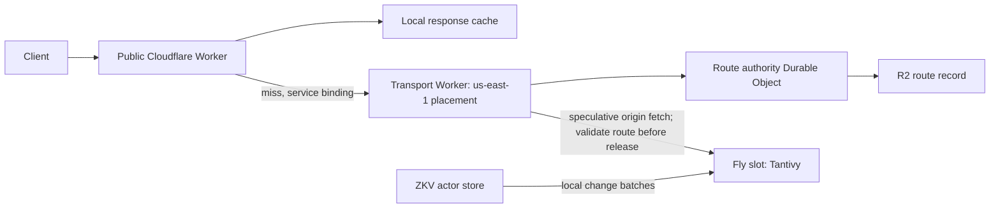

# Serving latency and Seek

Investigated 2026-11-16. Read-only production diagnostics and source review;
no engine experiment, deployment, resource change or load test.

The evidence favors investigating the serving path before replacing Tantivy
to improve public latency. Seek is nevertheless a credible index alternative:
its compact representation and separate build process deserve a comparison.
Adopting it unchanged would alter matching, ranking and filtering guarantees.
ZKV's durable actor store remains useful in either design.

## Evidence and versions

- Typeahead source: `966632c`; clean working tree before this investigation.
- Archived eval: [80 observations](../../data/eval/runs/2026-11-16T07-25-35.153Z.json),
  07:25–07:32 UTC, local laptop, 40 requests per provider.
- [Derived latency breakdown](2026-11-16-seek/latency-breakdown.json) records
  the input SHA-256, arithmetic, per-observation components and summaries.
- Marco/Seek: current default branch refreshed to
  [`4e13b9e4bf241a3fa1852172c832d9d505fbe423`](https://github.com/jazware/marco/tree/4e13b9e4bf241a3fa1852172c832d9d505fbe423).
  Source inspected; Seek was not built or benchmarked here.
- [Six diagnostic requests and index status](2026-11-16-seek/probes.json),
  08:18–08:19 UTC. Requests were sequential, five seconds apart. No Bluesky
  requests were added. These are separate diagnostics, not additional eval pairs.
- `/route` and the diagnostic responses identified slot A, global-merge,
  build `b1794463531-cp-edfe0f3fd1`, binary SHA-256
  `10999570a084bd6a7960db89a087b8874cd9963cf28996e62e02ead47c1ec2a6`.
  That matches the archived eval's build and binary. Live index contents keep
  changing; matching build IDs do not make the data snapshots identical.

## Where the measured time goes

| Saved observations, milliseconds | Mean | Median | p90 |
| --- | ---: | ---: | ---: |
| Typeahead, client to full body | 142.83 | 123.47 | 186.11 |
| Bluesky, client to full body | 96.23 | 87.30 | 119.67 |
| Typeahead public Worker duration | 99.58 | 84 | 111 |
| Within Worker: cache lookup | 6.28 | 6 | 9 |
| Within Worker: backend fetch through body | 93.30 | 79 | 104 |
| Outside Worker, paired elapsed minus Worker | 43.26 | 37.51 | 59.67 |

Rows are nested, not additive. The additive mean decomposition is approximately
43.26 outside the Worker + 6.28 cache lookup + 93.30 backend fetch = 142.83 ms.
Outside-Worker time includes client/network/connection/response costs; it is
not a pure wire-latency measurement. Server durations have millisecond rounding.

The mean gap is 46.60 ms. All 40 of our observations were cache misses, all
entered Cloudflare at ORD, and none fell back to Bluesky. Bluesky reported
20 `MISS` and 20 `REVALIDATED`; the eval currently labels the latter unknown.
Those are not established cache hits or equivalent cache states. The two passes
are not a controlled cold/warm experiment.

The backend interval includes the service binding, transport routing, Fly
round trip and engine. Three large intervals (`aoc`: 485 ms, `na`: 296 ms,
`fig (`: 247 ms) cannot be attributed to the engine from this archive.
Neither can we attribute the entire average gap to the network.

### Small diagnostic follow-up

| Query | Transport route check | Transport origin headers | Direct engine handler | Hydration within engine | Candidates visited |
| --- | ---: | ---: | ---: | ---: | ---: |
| `aoc` | 12 ms | 31 ms | 2.319 ms | 0.406 ms | 10 |
| `na` | 15 ms | 38 ms | 2.533 ms | 0.356 ms | 10 |
| `Justin Fa` | 27 ms | 34 ms | 1.492 ms | 0.307 ms | 16 |

Route and origin work overlapped on all three transport requests: do not sum
their timings. Direct `/debug/search` ran five seconds after each transport
request and used the same retrieval path. It may benefit from the preceding
request warming pages. These readings demonstrate fast engine responses on
the current corpus, not cold latency, tail latency or an SLO. The direct
handler timer includes normalization, retrieval, hydration, moderation and
response construction after admission, not external network travel.

All three searches opened 14 scorers over seven segments. They hydrated ten
actors, touched one to four segments for hydration, and spent 0.024–0.038 ms
in moderation. The following status read was ready, with six segments,
13,293,448 live actors and 2,322,919 deleted documents among 15,715,620 stored
documents. Segment counts change as commits and merges proceed.

## Serving architecture

The slots are configured in EWR. The saved routed requests used Fly's IAD
ingress; a Fly request-ID suffix describes ingress, not proof of machine
location. Direct diagnostic requests entered Fly through ORD.

The route authority keeps a short-lived validated route; a hint lets the
transport start the origin fetch while checking authority. This is already an
overlap optimization, not a serial R2 read followed by search on every request.
The response still waits for authority and must match the admitted build/binary.
Removing that check blindly would weaken failover correctness.

Two layers currently discard attribution: the transport overwrites the engine's
`Server-Timing`; the public handler then overwrites the transport's timing.
The public handler logs transport durations, but the saved eval preserves only
its outer timings. Preserve distinct `engine`, `transport_route`,
`transport_origin_headers`, and public-worker intervals in a future change.
The existing `search` name is used at different layers and must not be conflated.

Source: [public handler](../../src/handlers/search.ts),
[transport](../../src/search-transport.ts),
[validated search](../../src/validated-search.ts),
[route authority](../../src/route-authority.ts),
[engine handler](../../services/tantivy/src/server.rs).
Stats writes and response-cache writes are scheduled with `waitUntil`; the
archive provides no evidence that synchronous stats persistence is the delay.

Bluesky's public [AppView handler](https://github.com/bluesky-social/atproto/blob/main/packages/bsky/src/api/app/bsky/actor/searchActorsTypeahead.ts)
selects a search skeleton/dataplane path, hydrates profiles, filters blocks and
presents results. It does not reveal the active production engine or network
topology. Seek implements that dataplane interface; that does not establish
that our measured Bluesky requests run Seek.

## What differs at the index level

Our implementation already avoids scoring and sorting every broad match:
documents are rank-sorted, complete postings support conjunctions, and a heap
merges matching streams across segments until enough eligible actors survive.
PDS scope is included before candidate selection. Candidate/segment exhaustion
is an explicit failure rather than a successful truncated answer.

It nevertheless pays general search-engine costs: scorer construction for each
segment and pass, term/posting reads, rank-string decoding and heap comparisons,
stored JSON hydration, and ongoing replacement documents and segment merges.
The normalizer materializes handle/name prefixes as index keys. Rank columns
are already cached per generation; recommending that again would repeat the
optimization shipped in `0ec92d9`. Current merge settings, background warming
and lower merge-thread priority also already incorporate November 11 findings.

Seek's [index implementation](https://github.com/jazware/marco/blob/4e13b9e4bf241a3fa1852172c832d9d505fbe423/crates/seek-core/src/index.rs)
stores sorted keys with shared prefixes compressed in blocks of 16, packed
32-bit actor/tier postings, 16-bit ranks and a forward actor-to-keys table.
Prefix lookup locates a contiguous range. Heavy prefixes use precomputed
top-256 lists; narrow prefixes scan their range. A mapped immutable base and
live overlay replace continuous serving-index segment construction.

That layout can reduce allocations, pointer chasing, prefix expansion and
merge interference. This is a substantive design advantage to test, not a
Rust-versus-Zig comparison: our Tantivy engine and Seek are both Rust, and our
Zig normalizer is linked into the engine.

The author's [design measurements](https://github.com/jazware/marco/blob/4e13b9e4bf241a3fa1852172c832d9d505fbe423/docs/seek.html)
report logged-out engine microbenchmarks of 1.1 µs median / 20 µs p99 and a
single-client gRPC measurement of 153 µs / 327 µs with tracing disabled.
Those return DIDs/scores, not hydrated profiles over the public Internet.
They use different hardware, data and workload from our measurements; no
speedup ratio follows. The current operator design publishes a 2.56 GB artifact
every 15 minutes in its measured configuration: roughly 246 GB/day per pod
if each artifact is downloaded. Reported ready pod RSS is 2.57 GB, and builder
RSS 16.96 GB, with a separate graph/checkpoint workload. These are useful
operational costs to assess, not estimates for our smaller corpus.

## Could we just use it?

The relevant reusable component is **Seek**, rather than using Marco graph
lookups for prefix matching. Marco supplies follow/block relations and PageRank
inputs. Seek's `ActorIn` accepts a rank, so adapting the index to our existing
scores need not require operating the graph service. Mapping our f32 scores to
u16 and adding match-tier weights would change ordering and ties; it is not
automatically a semantics-preserving replacement.

| Boundary | What adoption would require |
| --- | --- |
| Multiword recall | Seek selects the narrowest word range and verifies only its best 64 candidates for arbitrary-order names. Our complete conjunction path must remain available or this guarantee must explicitly change. |
| Long queries and later words | Seek cuts folded keys/queries at 32 bytes and creates name starts for the first five words. Test against our full query and Unicode regressions. |
| PDS scope and preference | No corresponding filter in the inspected Seek search interface. Filtering a global top list afterwards cannot implement our contract. |
| Moderation and identity | Seek has hidden-state and viewer blocks; our expiring labels, policy overrides, domain rules and migration suppression need equivalent generation-consistent handling. Listblock filtering is left to its AppView. |
| Response payload | Seek returns DIDs/scores. We need co-located hydration and must still serve profiles/corpus counts, currently supplied by Tantivy. |
| Freshness and recovery | Its packaged builder/pods follow Jetstream and replay from artifact cursors. We require relay ingestion. A ZKV/change-log adapter must preserve cursor, tombstone and restart semantics. |
| Hosting | Packaged adoption adds an artifact builder/distribution lifecycle and, for its standard graph features, Marco. A library integration could avoid that whole deployment shape. |

The recall concern is concrete, not attachment to Tantivy. October's
`Justin Fa` investigation found that a valid multiword result can rank below
every truncated seed list. Seek uses a different implementation, but its
pre-verification cap admits the same class of omission. This is source-level
analysis of a documented tradeoff, not a newly reproduced Seek production bug.
Its phrase and joined-handle paths may rescue particular queries; they do not
prove arbitrary-order conjunction completeness.

Sources: Seek [query](https://github.com/jazware/marco/blob/4e13b9e4bf241a3fa1852172c832d9d505fbe423/crates/seek-core/src/query.rs),
[keys](https://github.com/jazware/marco/blob/4e13b9e4bf241a3fa1852172c832d9d505fbe423/crates/seek-core/src/keys.rs),
[operator contract](https://github.com/jazware/marco/blob/4e13b9e4bf241a3fa1852172c832d9d505fbe423/docs/seek.md).

ZKV is not on the current search request path. It durably holds actor records,
labels, policy, identity/refresh queues, tombstones, source cursors and the
atomic change log feeding the index. Replacing Tantivy would not replace those
responsibilities. Its current [key layout](../../services/src/store/keys.zig)
and [commit boundary](../../services/src/store/store.zig) are independent of
the retrieval representation. Co-located store work can still compete for
CPU/I/O; absence from the request call chain does not mean zero interference.

## Recommended order

1. Preserve timing attribution through both forwarding layers and the eval
   archive. Distinguish connection/cache state and inspect engine timings on
   naturally slow requests before assigning the old outliers a cause.
2. Compare transport placement/routing against a safe co-located path on an
   isolated target. Keep route validation, failover and scoped fallback intact.
   Current route/origin overlap means a faster route check alone may save no
   end-to-end time.
3. Evaluate Seek's reusable index against the existing semantic fixtures first:
   rare conjunctions, rejection/refill, PDS movement, Unicode/long queries,
   score changes and restart/rebuild equivalence. Test an unchanged Seek
   integration before assuming we should write our own version.
4. If adaptation is substantial, compare a compact-key/numeric-rank design or
   safe precomputed-prefix accelerator retaining complete retrieval. A top list
   needs evidence that omitted candidates cannot beat the answer; merely
   returning K matches is not enough. Preserve fallback on the cases it cannot
   establish. Measure memory, writes, cold tails and update interference along
   with speed on the same cloud-hosted corpus and resources.

PageRank and personalization are separate quality experiments. They should
not be credited as latency improvements, and unsigned comparisons do not
measure the benefits of viewer follows. No decision here requires abandoning
ZKV or establishes that Tantivy must remain the search engine.

README reviewed: no change needed because this is investigation evidence and
does not change runtime roles, deployment, API behavior or schedules.
