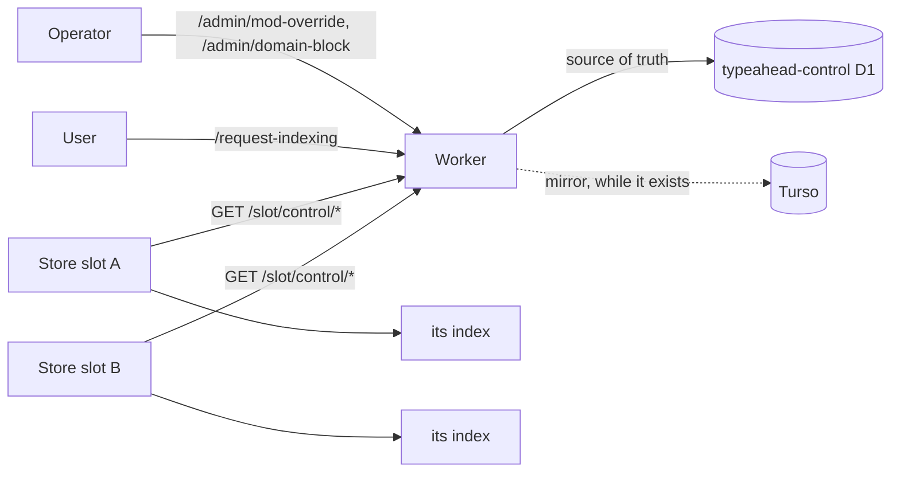

# Slot control

Status, 2026-11-12: built and tested locally on the `control-pull` branch. Nothing
here is deployed: the `typeahead-control` D1 database does not exist, no Worker
serves `/slot/control/*`, and no slot runs the control loop. The
[rollout](#rollout) below has not been run.

Search has been answered by store slots since 2026-11-11: Fly apps that follow
the relay themselves and keep the corpus in a store on their own disk
([plan](plans/embedded-store-service.md)). They never read Turso. Two things an
operator or a user asks the Worker for were still written only to Turso, so
since the cutover neither has reached search:

- moderation policy: `/admin/mod-override` and `/admin/domain-block`;
- `/request-indexing`, the homepage's "index this account" button.

This is how both reach every store slot.

## Shape

Slots take no inbound control. The Worker owns a durable control record, and
every slot pulls it outbound on its own schedule and applies it to its own
store. Nothing has to know how many slots there are or which one is routed, a
slot that was down when a change was made picks it up when it returns, and a
slot bootstrapped later picks it up on its first poll.



## The control record

The `typeahead-control` D1 database, bound to the public Worker as `CONTROL_DB`,
schema in `migrations/control-d1/0001_control_tables.sql`:

| table | holds |
|---|---|
| `mod_overrides` | `did`, `action` (`show` or `hide`), `reason`, `updated_at` |
| `blocked_domains` | `domain` (lowercase), `reason`, `updated_at` |
| `control_meta` | one row, `policy_revision`, which rises by one in the same transaction as every statement that changes either table above |
| `index_requests` | `seq` (AUTOINCREMENT), `did`, `requested_at` |

It is a database of its own rather than more tables in `typeahead-stats`:

- D1 restores a whole database. A slot refuses a policy revision lower than the
  one it holds, so restoring statistics must not be able to move the revision
  back.
- The statistics database is an optional mirror behind `STATS_DUAL_WRITE`; this
  one is a source of truth the admin endpoints and `/request-indexing` cannot
  answer without.

Every write goes through `src/control-store.ts`. A row changed by hand in D1
must raise the revision in the same statement batch, or slots that hold the
current revision will not ask again:
`UPDATE control_meta SET value = value + 1 WHERE name = 'policy_revision'`.

**Removals are carried by sending the whole policy.** The alternative is a feed
of changes with a tombstone for each removal. A tombstone has to be kept until
every slot that will ever exist has seen it, and a slot bootstrapped from an
older bundle has seen none. A slot that makes its store equal to a complete
snapshot cannot keep a rule that was removed, whatever it missed, and applying
the same snapshot twice changes nothing. The policy is a handful of rows (one
override and three blocked domains on 2026-11-12), so the whole of it is cheap.

**Indexing requests are a log**, because a request is an event and not a state.
The row holds the DID the Worker resolved and verified, never what the user
typed. A repeat for the same account within five minutes adds no row. The
hourly cron removes rows older than seven days; `seq` is AUTOINCREMENT, so a
removed sequence is never reused and a slot's stored position stays meaningful.

## Endpoints

Both are `GET`, read-only, answered `Cache-Control: no-store`, and need
`Authorization: Bearer $SLOT_CONTROL_SECRET`. The secret is used for nothing
else and is compared by SHA-256 digest. The Worker's admin secret is refused.
A slot secret shorter than 32 bytes, or equal to the admin secret, turns both
endpoints off (503), so a slot never holds a credential that can write.

| request | answer |
|---|---|
| `GET /slot/control/policy` | `200 {"revision": n, "overrides": [{"did", "action"}], "blocked_domains": ["…"]}`, `ETag: "policy-n"` |
| `GET /slot/control/policy?after=n`, or `If-None-Match: "policy-n"` | `304` when `n` is the current revision, else the `200` above |
| `GET /slot/control/index-requests?after=s&limit=l` | `200 {"requests": [{"seq", "did"}], "more": bool}`: sequences above `s`, ascending, at most `l` (1 to 500, default 100) |

Other answers: `400` for an `after` or `limit` that is not a plain number,
`401` for a wrong or missing bearer (counted against the strict rate limit per
address, `429` once it is exhausted), `503` when the Worker has no usable slot
secret.

What a slot can learn: which DIDs are overridden and how, which domains are
blocked, and which DIDs were asked for. Operator reasons are not served. A slot
holds all of that in its own store already.

## What the Worker writes

The admin endpoints and `/request-indexing` keep their requests, responses and
status codes. What changed is where they write:

- `/admin/mod-override` (`POST`, `DELETE`) and `/admin/domain-block` (`POST`,
  `DELETE`) write the control database, then Turso. `/admin/mod-overrides` and
  `/admin/domain-blocks` read the control database.
- `/request-indexing` appends the verified DID to `index_requests` as soon as
  the identity is verified, takes the override and blocked-domain checks behind
  its `hidden` answer from the control database, and then upserts the Turso
  row as before. It does not wait for a slot.

The control write comes first. When it fails the request fails with neither
store changed.

Turso is still written because the Turso-fed slots (`typeahead-tantivy-a` and
`-b`) are the rollback target and read `mod_overrides`, `blocked_domains` and
`actors.hidden` from it. That copy is `src/turso-policy-mirror.ts` and
`mirrorRequestedActor` in `src/handlers/admin.ts`: one call per handler. When
Turso is retired those calls and that file go. One thing has to be replaced
then: `DELETE /admin/mod-override` answers with the account's recomputed
`hidden`, which today is read from the Turso row.

## What a slot does

The control loop is `services/src/store_process/control.zig`, a thread of the
store role. It is on when `CONTROL_URL` and `SLOT_CONTROL_SECRET` are both set
(`services/src/store_process/config.zig`); every `CONTROL_POLL_SECONDS`
(default 30, each rest stretched by up to 20 %) it asks both endpoints.

**Policy.** It asks with `after=<stored revision>`, or with no `after` when the
store has never applied a revision. On a `200` it reads the store's overrides
and blocked domains, works out the difference, and hands the owner one
submission: `override_set`, `override_cleared`, `domain_blocked` and
`domain_unblocked` changes, with the revision as a cursor in the same commit.
The store recomputes `hidden` for each overridden account in that commit and
sweeps the handle range for each domain afterwards; a sweep is owed durably
until it finishes, so a restart resumes it. The index bridge sends the store's
overrides and blocked domains to the index with every push and heartbeat, and
the index decides visibility from them at query time.

So a change made at the Worker is in force in a slot's search after at most one
poll (36 s with the default interval) plus the bridge's next push: 5 s on the
slots when the change touches a stored account or anything else is changing,
and the 30 s heartbeat at the latest.

**A bootstrapped slot** holds whatever policy its bundle carried and no
revision. Its first poll therefore asks unconditionally and gets the whole
policy, and the difference removes what the Worker no longer holds.

**Indexing requests.** It asks with `after=<stored sequence>`. Each DID is
applied as the relay's `#identity` event for that account is
(`events.Changes.indexRequest`): the actor is created if the store has never
seen it and queued for identity resolution, and the resolution's result
requests a profile refresh. The Worker's word is only that the DID is worth a
look: the handle and PDS are what this slot's own resolver finds. An account
that is deactivated or deleted stays gone. The last sequence is stored in the
same commit. A slot takes at most ten pages of a hundred per poll.

**What it refuses.** A snapshot or page that is malformed in any part is
refused whole: a partial snapshot would read as the removal of every rule it
lacks. A policy revision below the stored one is refused, because the Worker's
revision only rises and a lower one is a stale or replayed answer. A page whose
sequences do not rise from the stored one is refused. Answers over 4 MiB or
slower than 15 s are dropped, a snapshot with more than 100,000 overrides or
domains is refused, and a redirect is not followed, so the secret goes to the
configured origin only. The Worker does not page the policy: if it ever grew
past those bounds, slots would report `malformed` or `no_response` and keep
the policy they have. A DID that is not a `did:plc` or `did:web`
is passed over and counted.

**When the Worker cannot be reached** the slot keeps serving with the policy it
last applied. Nothing else in the slot depends on the loop.

## Watching it

`GET /health` on the store process (port 8082, private) has a `control` block:

| field | meaning |
|---|---|
| `state` | `on`, or `misconfigured` with `problem` when the loop was asked for and cannot run. Absent when neither variable is set |
| `age_seconds` | seconds since both endpoints last answered, or since the start before they first have |
| `policy.revision`, `policy.checked_at`, `policy.applied_at` | the revision the store's policy equals, when the Worker last confirmed it, and when it last changed |
| `index_requests.sequence`, `.queued`, `.skipped` | the last request taken, and how many were queued or passed over since the start |
| `failures.total`, `.no_response`, `.unauthorized`, `.malformed`, `.older_revision`, `.last`, `.last_status`, `.last_at` | what went wrong, by kind |

The `store.heartbeat` span carries `control_age_seconds`,
`control_policy_revision`, `control_requests_sequence`, `control_failures`,
`control_unauthorized`, `control_malformed`, `control_older_revision` and
`control_misconfigured`.

Alert on:

- `control_age_seconds` above 300 on any slot: ten polls have failed, and a
  policy change made now would not be in force there. Search itself is
  unaffected.
- `control_misconfigured` true, or the `control_*` attributes missing from a
  slot that should have them.
- `control_policy_revision` differing between slots for more than a few
  minutes, or below the Worker's
  (`bunx wrangler d1 execute typeahead-control --remote --command "SELECT value FROM control_meta WHERE name = 'policy_revision'"`).
- `control_older_revision` or `control_malformed` rising at all. An older
  revision means the control database went backwards (see below).

A control configuration that cannot run does not stop the store role. A store
that will not start stops feeding its index, and the index stops answering
searches 120 s later; a store without the loop serves with the policy it has.

**If the control database is restored to an earlier time**, its revision drops
below what slots hold and they refuse every snapshot. Raise it past the highest
`control_policy_revision` any slot reports:
`UPDATE control_meta SET value = <that + 1> WHERE name = 'policy_revision'`.
Each slot then takes the restored policy on its next poll.

## Rollout

Each step is safe to stop after. Steps 1 to 3 change nothing anything reads.

1. **Create the database.** `bunx wrangler d1 create typeahead-control`, and
   put the `database_id` it prints in `wrangler.jsonc` in place of the zeros.
   `just deploy-worker` refuses to deploy while the placeholder is there.
2. **Apply the schema.**
   `bunx wrangler d1 migrations apply typeahead-control --remote`, then check:
   `bunx wrangler d1 execute typeahead-control --remote --command "SELECT name, value FROM control_meta"`
   answers `policy_revision`, 1.
3. **Carry Turso's policy over**, with `TURSO_URL` and `TURSO_AUTH_TOKEN` in
   the environment. The script only reads.

   ```sh
   just control-backfill-sql > backfill.sql   # read it: expect 1 override, 3 blocked domains
   bunx wrangler d1 execute typeahead-control --remote --file backfill.sql
   just control-check                          # exits 0 with "0 differences"
   ```

   This has to precede the Worker deploy: from then on the listings and
   `/request-indexing`'s moderation answer come from the control database.
   Running the SQL again changes no rule.
4. **Give the Worker the slot secret.** Generate one value for the Worker and
   both slots (`openssl rand -hex 32`), keep it out of the shell history, and
   `bunx wrangler secret put SLOT_CONTROL_SECRET`. The deployed Worker does
   not read it yet.
5. **Deploy the Worker**: `just deploy-worker`. Its smoke suite exercises
   `/request-indexing` and the override endpoints against production, which
   now write both stores. Then, from anywhere:

   ```sh
   curl -s -o /dev/null -w '%{http_code}\n' https://typeahead.waow.tech/slot/control/policy    # 401
   curl -s -H "Authorization: Bearer $SLOT_CONTROL_SECRET" https://typeahead.waow.tech/slot/control/policy
   curl -s -H "Authorization: Bearer $SLOT_CONTROL_SECRET" 'https://typeahead.waow.tech/slot/control/index-requests?after=0&limit=5'
   just control-check
   ```

   The policy answer lists the same override and domains step 3 carried. At
   this point the Worker records everything and no slot pulls it: search
   behaves exactly as before the deploy.
6. **Give each slot the secret, staged**, so setting it restarts nothing:
   `fly secrets set --stage SLOT_CONTROL_SECRET=… -a typeahead-shadow-b`, and
   the same for `-a`. An image without the loop ignores it.
7. **Deploy the slot image** from this tree, which carries `CONTROL_URL` in
   `deploy/shadow-slot/fly.toml`. Do the slot that is not serving first and
   check it before the other. A deploy restarts the machine, so deploy the
   serving slot the way any image reaches it; what a restart costs is in
   [sizing](../deploy/shadow-slot/sizing.md#what-a-store-restart-costs-the-watermark).
   On the machine, read-only:

   ```sh
   fly ssh console -a typeahead-shadow-b -C "curl -s localhost:8082/health" | jq .control
   ```

   `state` is `on`, `policy.revision` is the Worker's, `failures.total` is 0
   and `age_seconds` is under a minute. The first poll applied the whole
   policy; with the policy the slot was bootstrapped with it changes nothing.
   This is also the first time a slot's requests cross Cloudflare's edge to
   `/slot/control/*`, which has not been tried: the Browser Integrity Check
   exception in [edge configuration](operations.md#edge-configuration) covers
   `/xrpc/` only. A request the edge turns away shows as
   `failures.unauthorized` with `last_status` 403, or as `failures.last` being
   `status`; the slot is otherwise unaffected. The ingester reaches `/admin/*`
   on the same hostname from Fly (`TYPEAHEAD_URL` in `services/fly.toml`).

To see a change go through, hide a test account and watch a slot's own search
drop it within a minute, then clear the override:

```sh
curl -s -X POST -H "Authorization: Bearer $ADMIN_SECRET" -H 'Content-Type: application/json' \
  -d '{"did":"did:plc:…","action":"hide","reason":"control rollout check"}' https://typeahead.waow.tech/admin/mod-override
curl -s 'https://typeahead-shadow-b.fly.dev/search?q=<its handle>&limit=5'
curl -s -X DELETE -H "Authorization: Bearer $ADMIN_SECRET" 'https://typeahead.waow.tech/admin/mod-override?did=did:plc:…'
```

The public API caches a search for 60 s, so ask the slot's own origin.

States in between, all safe:

| state | effect |
|---|---|
| database and backfill done, old Worker | nothing reads the database |
| new Worker, no slot secret on it | endpoints answer 503; admin and `/request-indexing` work |
| new Worker, slots on the old image | changes are recorded and not yet pulled, as before this work |
| new slot image, no secret on the slot | the loop is off, `control.state` is `misconfigured`, logged at the start |
| new slot image and secret, Worker unreachable or refusing | the slot serves with the policy it has; `control.failures` and `age_seconds` rise |

## Undo

- **A slot**: `fly secrets unset --stage SLOT_CONTROL_SECRET -a <app>` and
  deploy, or deploy an image from before this change. The store keeps the
  policy it last applied and the two cursors; an older build ignores them and
  the owed-sweep marks.
- **The Worker**: deploy the previous version. Turso has every change made in
  between, because the new handlers write it too. Policy changes made after the
  rollback are then missing from the control database; before deploying this
  Worker again, repeat step 3 and resolve what `just control-check` lists
  (`backfill.sql` never overwrites a rule the control database already holds,
  and never removes one).
- **The database** can stay; nothing else reads it.

## Smoke and the one production override

`scripts/smoke.py` clears and re-sets the `show` override on its test account
on every Worker deploy. A slot that polls between those two requests drops the
override for one poll interval, as a Turso-fed slot's poll could before.

## Tests

- `bun test`: the control store against a local D1 built from the migration
  (`src/control-store.test.ts`), the slot endpoints, their auth and ETag
  (`src/handlers/slot-control.test.ts`), the admin endpoints and
  `/request-indexing` writing both stores with their old responses
  (`src/handlers/admin-policy.test.ts`, `request-indexing.test.ts`), and the
  backfill and check (`src/control-backfill.test.ts`).
- `cd services && zig build test`: the loop against a stand-in Worker
  (`control_test.zig`: apply, removal, a slot that missed ten changes, restarts
  before and after the commit, an unreachable or refusing Worker, malformed and
  oversized answers, an older revision, a bootstrapped store, request paging and
  order, the real transport against a loopback server, and the role running the
  loop); the two cursors and the owed-sweep mark in the store's model test; a
  sweep interrupted by a restart (`owner_test.zig`); and the differential run,
  where policy changes and requests are mixed into the random sequence and the
  admin endpoints' SQL is restated in `sql_model.zig`.
- `just --no-dotenv test-bridge`: `services/src/control_e2e_test.zig` takes a
  policy change from a stand-in Worker through the real loop, store and bridge
  into the real Tantivy server, and checks its `/search`.
